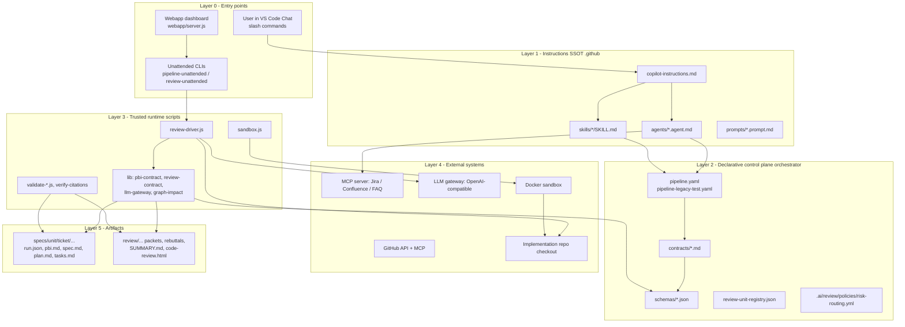
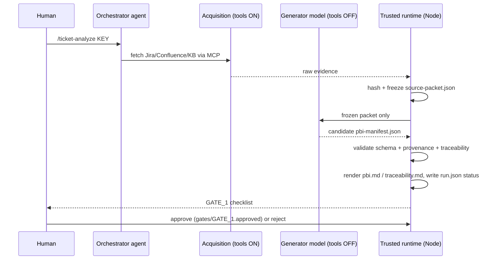

# 01 — Architecture

## 1. Purpose

An **agentic control plane** that sits *beside* an implementation repo and drives AI agents (GitHub Copilot primary, Codex CLI fallback) through gated, evidence-backed workflows:

1. **Ticket Analysis Pipeline** — Jira ticket → `pbi.md` → `spec.md` → `plan.md` → `tasks.md` → TDD implement → code review → Confluence publish.
2. **Code Review Runtime** — PR / branch / ticket review with frozen context, worker waves, repro tests, red-team rebuttal, citation verification.
3. **Legacy Test Coverage Pipeline** — business-first tests for legacy code that has no spec (JaCoCo/Surefire evidence, fixture reuse).
4. *(Extended edition)* **Business Rule Graph** — deterministic scanners that build an API/Mobile/Flow graph of the implementation code, used for impact analysis and a knowledge base.

## 2. Design principles (invariants)

| # | Principle | How it is enforced |
|---|---|---|
| P1 | **Models produce candidates; trusted code decides.** A model never writes `valid`, `passed`, `approved`, `handoff_ready`, gate or stage status. | `FORBIDDEN_MODEL_FIELDS` in `scripts/lib/pbi-contract.js`; `validateReview` in `scripts/lib/review-contract.js` |
| P2 | **Evidence before model.** Jira/Confluence/KB evidence is captured and frozen (SHA-256) before semantic generation. Generation runs with **no tools**. | `common/source-packet.json` + `pbi-manifest-writer` agent with `tools: []` |
| P3 | **Artifacts are the hand-off contract**, not chat history. | `handoff.artifact_is_contract: true` in `orchestrator/pipeline.yaml` |
| P4 | **Humans own gates** `GATE_1`…`GATE_5`. Nothing bypasses a failed validator or a human gate. | `gates:` in pipeline YAML; `gates/GATE_N.approved` marker files |
| P5 | **Honest statuses only**: `EXECUTED_PASS`, `EXECUTED_FAIL`, `INSPECTED_ONLY`, `NOT_RUN`, `ENVIRONMENT_BLOCKED`, `NOT_APPLICABLE`. Code review stays `INSPECTED_ONLY`. | `run.json` ledger + validators |
| P6 | **Every claim is source-backed or explicitly `INFERRED`**; ambiguity becomes a blocking Open Question, never a guessed requirement. | PBI contract evidence kinds `SOURCE` / `DERIVED` / `INFERRED` |
| P7 | **Single source of truth (SSOT)** for agent customization is `.github/`; Codex layout is generated. | `scripts/sync-codex.js --check` |
| P8 | **Isolated execution**: builds/tests run in a per-ticket Docker sandbox, never on the host. | `scripts/sandbox.js`, `sandbox-execution` skill |
| P9 | **Anti-leak coverage**: every diff hunk / requirement / unit is accounted for by set equality. | `review-enumerate.js`, coverage ledger, `chunking` skill |

Source-of-truth precedence (earlier wins):
1. `orchestrator/pipeline.yaml` / `pipeline-legacy-test.yaml`
2. `orchestrator/contracts/` + `orchestrator/schemas/`
3. Stage agent / skill + referenced template
4. `run.json` (execution state only, never a quality authority)

## 3. Layered architecture

## 4. Trust boundary

Key point: the **only** component allowed to write a status is the trusted runtime; the only component allowed to approve is a human.

## 5. Two-repo model

| Repo | Owns |
|---|---|
| Workflow repo (this kind of project) | pipelines, agents, skills, contracts, scripts, templates, webapp, generated artifacts under `specs/` and `review/` |
| Implementation repo (e.g. `{{IMPL_REPO_NAME}}`) | product code + tests; mutated only by the `implement` stage inside the sandbox |
| MCP server repo | Jira / Confluence / FAQ tool server (Python FastMCP) |
| Graph data store (optional, `{{graph.bd_root}}`) | generated Business Rule Graph JSON + explorer HTML |

## 6. Editions compared

| Area | Extended | Core |
|---|---|---|
| Pipelines, contracts, schemas, templates | yes | yes (same) |
| 19 agents, ~23 skills, SSOT sync to Codex | yes | yes |
| Review runtime (driver, unattended, repro, citations, coverage map, retro) | yes | yes |
| Webapp PR dashboard | yes | yes |
| `scripts/lib/executor-adapters/` (pluggable executors) + `probe-executors.js` | yes | no |
| `scripts/lib/review-matrix-contract.js` + `validate-review-matrix.js` | yes | no |
| Business Rule Graph: `api-inventory`, `mobile-inventory`, `flow-trace`, `build-explorer`, `regen-all`, `gap-analysis`, `impact-report`, `render-knowledge-base` | yes | only consumer lib `graph-impact.js` |
| PR comment analytics: `crawl-pr-comments`, `analyze-causes` | yes | no |
| Diagnostics: `probe-ratelimit`, `test-gateway`, `test-embed`, `test-fetch`, `read-session` | yes | no |
| `research/`, `memories/`, real `specs/`, `review/` outputs | yes | no |
| Tracker/wiki MCP server | external | optional `mcp-server/` |

Recommendation for a new project: start from the **Core** edition, then enable the Extended modules as optional feature flags (see `04-parameters.md` → `features.*`).
