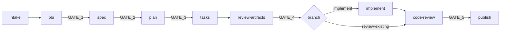
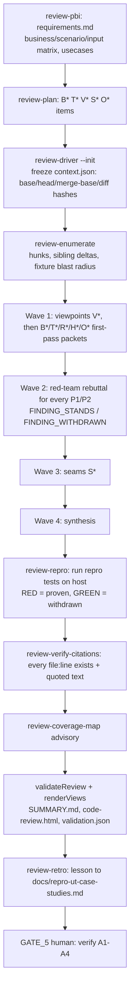
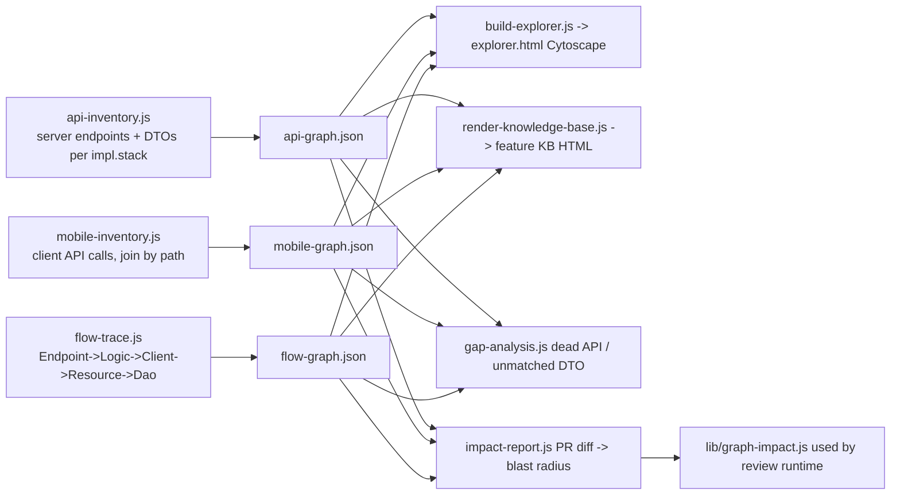

# 02 — How It Works

## 1. Ticket Analysis Pipeline (9 stages, 5 human gates)

Defined in `orchestrator/pipeline.yaml`. Entry: `/ticket-analyze <KEY>` (chat) or `node scripts/pipeline-unattended.js --ticket <KEY>`.

| Stage | Agent | Input | Output (under `specs/<unit>/<ticket>/`) | Gate |
|---|---|---|---|---|
| `intake` | `intake` (+ `image-transcriber`) | Jira key | `common/source-packet.json`, intake-profile `pbi-manifest.json`, `pbi.md` | — |
| `pbi` | `pbi-manifest-writer` (no tools) | frozen packet | `common/pbi-manifest.json`, `pbi.md`, `traceability.md` (rendered) | GATE_1 |
| `spec` | `spec-writer` | `pbi.md` | `common/spec.md` | GATE_2 |
| `plan` | `plan-writer` | `spec.md` | `server/plan.md` | GATE_3 |
| `tasks` | `tasks-writer` | spec + plan | `server/tasks.md` | — (auto-continue) |
| `review-artifacts` | `reviewer` | all artifacts | `tasks.review.html` | GATE_4 |
| `implement` | `implement` | `tasks.md` | code in impl repo (TDD, sandbox) | — (manual) |
| `code-review` | `code-reviewer` + `red-team-reviewer` | checkout + review artifacts | findings, repro tests, rebuttals, suggestions | GATE_5 |
| `publish` | orchestrator | all | Confluence page | — (manual) |

### Per-stage mechanics
1. Orchestrator reads `run.json.current_stage` (resume support).
2. Loads only the stage agent + skill + template (keeps context small).
3. Agent writes a **candidate** artifact.
4. Trusted validator runs (`pbi-contract.js validate`, template checks, `validate-pipeline.js`).
5. Runtime writes stage status into `run.json`. `EXECUTED_PASS` only if validation passed.
6. If stage has a gate → stop, show checklist. Human approves (`--approve GATE_N` creates `gates/GATE_N.approved`) or rejects (`fix-and-rerun`).

### Intake / PBI detail
- Acquisition uses MCP `investigate_issue`, Confluence/KB search. Images saved to `assets/`, transcribed by `image-transcriber` → `IMAGE_TRANSCRIPT` source (`DERIVED`). No vision model → `INACCESSIBLE` + blocking open question.
- Packet is hashed and frozen. Human clarifications become `USER_CLARIFICATION` sources and force re-run.
- Manifest contains: decision variables, business matrix (incl. negative + boundary), scenarios, AC→matrix→scenario traceability, platform dispositions (server/ios/android), open questions.
- `pbi.md` / `traceability.md` are **rendered views** — never model-authored.

## 2. Code Review Runtime

Entry points:
- Chat: `/review-pbi <base>...<head> --ticket KEY` → `/review-plan` → `/ticket-review KEY --business B1|--technical T1|--viewpoint V1|--seam S1`
- PR: `/pr-review <PR>`; branch: `/branch-review-plan` → `/branch-review`; author: `/pr-self-review`
- Unattended: `node scripts/review-unattended.js --repo <owner>/<repo> --pr N`
- Webapp: "Review" button → queue → `review-unattended.js`

Rules:
- Workers are **read-only**, return role-scoped JSON packets validated against `orchestrator/schemas/review.schema.json`.
- Driver re-verifies frozen context before/after every worker (detects checkout drift).
- Every surviving finding: evidence `file:line`, failing usecase, repro command + output, ASIS excerpt, suggested change, impacted usecases. Convention-only findings: `N/A — coding-convention`.
- Large diffs → `chunking` skill (≤50k LOC per 200k ctx), coverage ledger with set equality, mandatory seam review.
- Risk routing: `.ai/review/policies/risk-routing.yml` maps paths → concerns → mandatory units (`fail_closed`).
- Unit groups from `orchestrator/review-unit-registry.json`: `B*` business, `T*` technical, `R*` tickets, `H*` hypotheses, `O*` orphans, `V*` viewpoints, `S*` seams.

Pre-submission gate (author): A1 self-review with checklist, A2 `/pr-self-review` (fix/defer P1/P2), A3 CI green, A4 Copilot comments resolved.

## 3. Legacy Test Coverage Pipeline (7 stages, 4 gates)

`orchestrator/pipeline-legacy-test.yaml`, prompts `/legacy-test-scan|charter|implement|review|publish`.

| Stage | Agent | Output | Gate |
|---|---|---|---|
| `inventory` | `coverage-surveyor` | `coverage-inventory.md` | — |
| `triage` | `coverage-surveyor` | `test-backlog.md` | GATE_1 |
| `charter` | `test-charter-writer` | `test-charter.md` (scenario matrix `SCN-*`, fixture reuse plan) | GATE_2 |
| `implement-tests` | `legacy-test-implementer` | tests + `implementation-log.md` | — |
| `verify-coverage` | `coverage-verifier` | `coverage-delta.md` (every branch TESTED/EXCLUDED/DELETED) | GATE_3 |
| `review` | `test-quality-reviewer` | `test-review.md` | GATE_4 |
| `publish` | `legacy-test-orchestrator` | `coverage-report.html` | — |

Build rule: clean + coverage agent + test in **one** invocation (e.g. `mvn clean jacoco:prepare-agent test -Dtest=<Class>`) so stale IDE classes never leak.

## 4. Unattended runners

| Runner | Flow |
|---|---|
| `pipeline-unattended.js` | for each stage: build prompt → run executor (`copilot` / `codex exec`) → validate → stop at gate. Resume via `--run`. Approve via `--approve GATE_N`. |
| `review-unattended.js` | prepare checkout / per-PR git worktree → refresh GitHub token → plan (review-pbi+review-plan) → freeze → fleet (`copilot --fleet`) or `codex exec` → repro → validate → retro. Env `UNATTENDED_*`. |
| `review-copilot.js` | executor adapter for the driver; BYOK via `COPILOT_API_URL/KEY/MODEL` or LLM gateway. |

## 5. Webapp dashboard

`npm run setup` (first time) → `npm start` → `scripts/start-server.js` (load `.env`, create `webapp/config.json` if missing, corporate CA from `webapp/*.pem`, free port, open browser) → `webapp/server.js` (port 8787, bound to `127.0.0.1`, cross-origin writes rejected). Server is split into `webapp/lib/*` (shared state, runner, settings) and `webapp/routes/*` (one module per API area).
- Lists PRs of team members / assigned to me (`webapp/gh.js`, GitHub REST via undici, token from `GITHUB_TOKEN` or `gh auth token`).
- `POST /api/review/start` creates `specs/pr-reviews/<slug>/run.json` and enqueues a **sequential** job (`queue-state.json`, logs in `queue-logs/`) that spawns `review-unattended.js`.
- Progress, artifact tree/file viewer, report generation endpoints.
- Settings tab (reference v1): run settings, repos/members, workspace folder, proxy, write-only secrets (`.env`), health check (`/api/setup/doctor`), repository clone. Stored in `webapp/config.json`; the blueprint target is the layered config + schema-driven **Settings UI** (see [07](07-settings-ui-and-host-setup.md) §A0).

## 6. Sandbox

`node scripts/sandbox.js create <TICKET>` → container from `scripts/sandbox/Dockerfile` + DB container (e.g. postgres), mounts impl repo worktree + Maven cache. Commands: `exec`, `shell`, `review`, `regen`, `stop/start`, `rm [--purge]`. One sandbox per ticket; switch sandbox when switching ticket.

## 7. MCP server (Jira / Confluence / FAQ)

`mcp-server/server.py` — Python FastMCP, `httpx` + `truststore` (OS cert store for TLS-inspecting proxies), sensitive-data sanitizer (e.g. card numbers, tokens). Tools: `jira_*`, `confluence_*`, optional `kb_*` (internal FAQ / knowledge base), plus composite `investigate_issue`, `get_bug_investigation_pack`, `get_feature_context`, `search_knowledge_base`. Run via `uv` or Docker; env `JIRA_URL`, `JIRA_PAT`, `CONFLUENCE_URL`, `CONFLUENCE_PAT`. Registered in `.vscode/mcp.json`.

## 8. Business Rule Graph (Extended edition)

`regen-all.js` runs the scanners in order. Everything is deterministic (no LLM), each node has a `file:line` anchor; cache per HEAD sha under `{{graph.bd_root}}/graphs/cache/<sha8>/`. Scanners are stack-specific adapters selected by `impl.stack`.

## 9. SSOT sync to Codex

`node scripts/sync-codex.js` (`npm run sync:codex`):
- `.github/copilot-instructions.md` → `AGENTS.md`
- `.github/agents/*.agent.md` → `.codex/agents/*.toml`
- `.github/skills/<n>/SKILL.md` → `.codex/skills/<n>/`
- `.github/prompts/*.prompt.md` → `.codex/prompts/*.md`
- `--check` exits 1 if stale; `--home` also installs into `~/.codex/`.

## 10. Advisory tooling (never gates)
- `stage-info-gain.js` — embedding similarity + n-gram coverage between consecutive artifacts (detects paraphrase / drift).
- `review-coverage-map.js` — embeddings map hunks ↔ plan items.
- `scripts/lib/llm-gateway.js` — OpenAI-compatible client: proxy agent, concurrency pool, server-header rate limiting, 429 `Retry-After`, per-model budgets, `chatJson`.
