# 05 — Generation Plan (build a new project like this)

Build in phases. Each phase has a **Definition of Done (DoD)** and a verification command; do not start the next phase until verification passes. Prompts for each phase are in [06-generation-prompts.md](06-generation-prompts.md).

Reference sources (optional, read-only): if `reference.core_repo`, `reference.extended_repo`, `reference.mcp_repo` are set in `project.config.yaml`, generators may port logic from them; otherwise generate from the blueprint docs alone.

```mermaid
flowchart LR
  P0[P0 Config + skeleton] --> P1[P1 Control plane YAML/contracts/schemas]
  P1 --> P2[P2 Trusted libs + validators + tests]
  P2 --> P3[P3 Templates]
  P3 --> P4[P4 Agents + skills + instructions]
  P4 --> P5[P5 Review runtime]
  P5 --> P6[P6 Unattended runners + sandbox]
  P6 --> P7[P7 Webapp]
  P7 --> P8[P8 MCP server + Codex sync]
  P8 --> P9[P9 Optional: graph / analytics + docs + E2E]
```

| Phase | Deliverables | DoD / Verify |
|---|---|---|
| **P0 Config & skeleton** | dir tree, `package.json`, `.gitignore`, `.env.example`, `project.config.yaml`, `config.local.yaml` (git-ignored), `orchestrator/schemas/project-config.schema.json` with `x-ui` hints, `scripts/lib/config.js` (layered merge + source tracking + hot reload), `scripts/render-config.js` (`--dry-run` diff), `scripts/setup-wsl.sh` | `node scripts/lib/config.js --print` prints resolved config + source per key; invalid config exits 1 |
| **P1 Control plane** | `pipeline.yaml`, `pipeline-legacy-test.yaml` (if `features.legacy_tests`), `contracts/*.md`, `schemas/source-packet|pbi-manifest|review.schema.json`, `review-unit-registry.json`, `jql-queries.md`, `.ai/review/policies/risk-routing.yml` — all with `{{param}}` placeholders | `node scripts/render-config.js` leaves no `{{`; YAML parses |
| **P2 Trusted libs** | `lib/pbi-contract.js`, `lib/review-contract.js`, `lib/llm-gateway.js`, `pbi-contract.js` CLI, `validate-pipeline.js`, `validate-legacy-pipeline.js`, tests | `npm test` + `npm run validate` green; tests cover forbidden model fields, hash mismatch, orphan AC, unresolved placeholder |
| **P3 Templates** | all files in `templates/` (run ledgers, spec/plan/tasks, review policy/prompt/plan/requirements, severity rubric, code-review) | `validate-pipeline.js` resolves every `reference:` path |
| **P4 AI customization** | `.github/copilot-instructions.md` (≤150 lines), agents, skills, prompts generated per `features.*` | every agent/skill has valid frontmatter; every `agent:` in pipeline exists; `pbi-manifest-writer` has `tools: []` |
| **P5 Review runtime** | `review-driver.js`, `review-enumerate.js`, `review-repro.js`, `review-verify-citations.js`, `review-dump-prompt.js`, `review-retro.js`, `review-copilot.js`, (`review-coverage-map.js` if embeddings) | `test/review-driver.test.js` with git fixture: init → dry-run waves → validate; tamper checkout → verify fails |
| **P6 Runners & sandbox** | `pipeline-unattended.js`, `review-unattended.js`, `jira-evidence.js`, `sandbox.js`, `scripts/sandbox/Dockerfile` (per `impl.stack`) | `--dry-run` of both runners prints stage plan; `sandbox.js create TEST-1` then `rm` works |
| **P7 Webapp** | `webapp/server.js` + `lib/` + `routes/`, `gh.js`, `public/index.html`, `start-server.js`, `setup.js` (`npm run setup` / `doctor`); **Settings UI** (schema-driven form, `/api/settings*`, secrets write-only, test buttons, apply with diff), **Repositories** (clone/fetch/worktree manager), **first-run wizard** `/setup` | `npm start` serves `/`; `GET /api/settings` hides secrets; PUT invalid value → 400 with field error; apply dry-run returns diff; clone of disallowed host → 403 |
| **P8 MCP + Codex** | MCP server (Python FastMCP) or `.vscode/mcp.json` pointing to existing one; `sync-codex.js` | `npm run sync:codex:check` exit 0; MCP `debug_test_connection` ok |
| **P9 Optional + docs + E2E** | graph scanners / PR analytics if enabled; `docs/` (architecture, pipeline-design, code-review-workflow, vscode-chat-guide, customization, webapp) | E2E: `/ticket-analyze <real KEY>` reaches GATE_1 with validated manifest; `/pr-review <PR>` produces SUMMARY.md + citation check pass |

## Stop conditions
- A validator cannot be made deterministic → stop, raise open question.
- Generated file contains a hard-coded value that exists in `project.config.yaml` → fix before continuing.
- Any model-authored status field appears in an artifact → fail the phase.

## Making it dynamic — mechanism
1. **Config** — layered: schema defaults → `project.config.yaml` (team) → `config.local.yaml` (machine) → `.env` secrets → env → CLI; edited through the Settings UI (see 07).
2. **Template rendering** — source templates under `blueprint/templates-src/**` (or inline in prompts) with `{{dotted.key}}`; `scripts/render-config.js` writes `.github/`, `orchestrator/`, `templates/`. Conditional blocks: `{{#if features.legacy_tests}} ... {{/if}}`.
3. **Feature gating** — `render-config.js` skips files whose front matter has `feature: <flag>` when the flag is false; `validate-pipeline.js` skips stages for disabled features.
4. **Stack adapters** — `impl.stack` selects: sandbox Dockerfile, test command, coverage parser (JaCoCo / Istanbul / coverage.py), legacy-test patterns, graph scanner set.
5. **Re-generation** — changing config → `npm run render && npm run sync:codex && npm run validate && npm test`.
