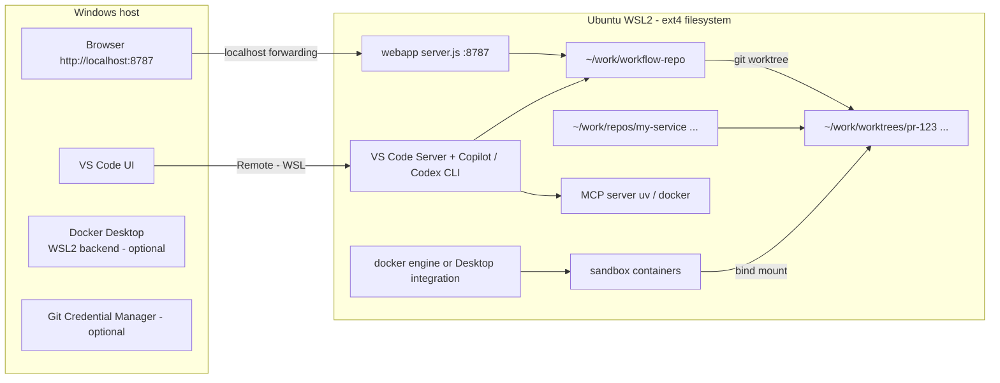
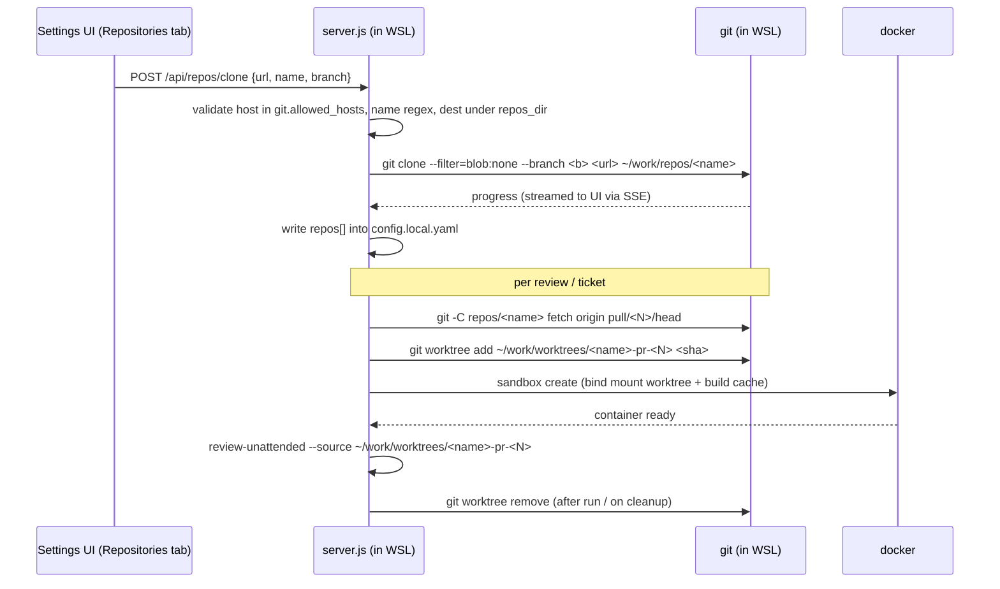

# 07 — Settings UI & Host Setup (Ubuntu/WSL2 on Windows)

Two topics:
- **A.** Move configuration from hand-edited YAML into a **Settings UI** in the webapp.
- **B.** Run everything in **Ubuntu (WSL2) on a Windows host**, with all sources cloned inside Ubuntu.

---

## A. Settings UI

### A0. Reference implementation status (v1) vs. target

The reference repo ships a smaller **v1**. Generated projects should build the target, using v1 as the migration starting point.

| Topic | Reference v1 (implemented) | Target (this doc) |
|---|---|---|
| Storage | one file `webapp/config.json` (git-ignored, via `scripts/lib/webapp-config.js`) + `.env` | layered config A1 via `scripts/lib/config.js` |
| Form | hand-coded fields, server-side whitelist validation | schema-driven (`x-ui`) |
| Save | `POST /api/settings` (partial body, applied to in-memory config, then persisted) | `PUT /api/settings {scope, patch}` + audit + `.bak` |
| Secrets | `POST /api/settings/secret {name, value}`; names limited to `SECRET_NAMES`; empty value removes; status only `{name, set, source}` | `PUT /api/settings/secret/:name`, optional keychain |
| Health | `GET /api/setup/doctor` → `node scripts/setup.js --check --json` (node, deps, git, gh + auth, copilot/codex, docker, config, .env, mcp.json placeholders + plain-text tokens, WSL `/mnt` check) | first-run wizard `/setup` (A6) + test buttons |
| Clone | `POST /api/repos/clone {owner, repo}` → `gh repo clone <o/r> <workspaceDir>/<owner>/<repo> -- --filter=blob:none`; poll `GET /api/repos/clone/status`; on success registers `repos[]` + `sourceCheckouts` | allow-listed hosts, SSE progress, fetch policy (B4) |
| Worktrees | opt-in `worktrees: true`; per-PR detached worktree next to the main checkout, removed after the run, orphans swept | `{{paths.worktrees_dir}}` |
| Security | bind `127.0.0.1` (`HOST` override), reject cross-origin writes by `Origin` vs `Host` | + CSRF token, auth token on LAN, rate limits |
| Not yet | test buttons, apply/render diff, history/audit, `/api/repos/fetch`, team/machine scope split | — |
### A1. Config layers (low → high precedence)

| # | Layer | File | Written by | Committed? | Holds |
|---|---|---|---|---|---|
| 1 | Defaults | `orchestrator/schemas/project-config.schema.json` (`default`) | developers | yes | safe defaults |
| 2 | Team config | `project.config.yaml` | Settings UI (scope `team`) or PR | **yes** | tracker keys, labels, stack, features, review policy |
| 3 | Machine config | `config.local.yaml` | Settings UI (scope `machine`) | **no** (git-ignored) | paths, repos to clone, proxy, CA, `github.me`, port, runtime host |
| 4 | Secrets | `.env` (mode 600) or OS keychain | Settings UI (write-only) | **no** | `JIRA_PAT`, `CONFLUENCE_PAT`, `GITHUB_TOKEN`, `OPENAI_API_KEY` |
| 5 | Env vars | process env | shell / CI | — | overrides |
| 6 | CLI flags | args | user | — | per-run overrides |

`scripts/lib/config.js` merges 1→6, validates the result against the schema, deep-freezes it, and records the **source layer of each key** so the UI can show "from team / machine / env".

### A2. Schema-driven form

The UI is generated from the JSON schema, with no hand-coded form. Each property carries `x-ui` hints:

```json
"jira": {
  "type": "object",
  "x-ui": { "group": "Tracker", "order": 2 },
  "properties": {
    "url":         { "type": "string", "format": "uri", "pattern": "^https://",
                     "x-ui": { "scope": "team", "test": "jira" } },
    "project_key": { "type": "string", "pattern": "^[A-Z][A-Z0-9]+$",
                     "x-ui": { "scope": "team", "rerender": true } },
    "pat_env":     { "type": "string", "default": "JIRA_PAT",
                     "x-ui": { "scope": "secret", "secretName": "JIRA_PAT" } }
  }
}
```

| `x-ui` key | Meaning |
|---|---|
| `group`, `order` | tab / section placement |
| `scope` | `team` → `project.config.yaml`, `machine` → `config.local.yaml`, `secret` → `.env`/keychain |
| `widget` | `text`, `password`, `select`, `multiselect`, `path`, `repo-list`, `command`, `toggle` |
| `rerender` | changing it requires re-rendering `.github/`, `orchestrator/`, `templates/` |
| `restart` | changing it requires a webapp restart (e.g. `webapp.port`) |
| `test` | id of a connectivity test button (`jira`, `confluence`, `github`, `llm`, `docker`, `repo`) |
| `dangerous` | needs a confirm dialog and an audit entry (e.g. `impl.build.test_cmd`) |

Settings tabs: **General · Tracker · Wiki · Git host · Repositories · LLM & Executors · Network · Sandbox · Review policy · Features · Secrets · Apply & History**.

### A3. API

| Method | Path | Behavior |
|---|---|---|
| GET | `/api/settings/schema` | schema with `x-ui` |
| GET | `/api/settings` | merged config, **secrets redacted** to `{set: true/false}`, plus `source` per key |
| PUT | `/api/settings` | body `{scope, patch}`. Validates the merged result against the schema, writes atomically (`.bak` kept), appends to `settings-audit.log` |
| PUT | `/api/settings/secret/:name` | write-only; value goes to `.env`/keychain and is never returned |
| POST | `/api/settings/test/:kind` | connectivity test (Jira `/myself`, Confluence `/space`, GitHub `/user`, LLM `/models`, `docker info`, `git ls-remote`) |
| POST | `/api/settings/apply` | runs `render-config` in dry-run mode and returns a diff of generated files. With `{confirm:true}` it writes them, then runs `sync-codex` + `validate` + `test` |
| GET | `/api/settings/history` | audit log plus a git log of `project.config.yaml` |
| POST | `/api/repos/clone` / `/api/repos/fetch` | clone or update repositories (see B4) |

### A4. Apply flow

```mermaid
sequenceDiagram
  participant UI
  participant S as server.js
  participant C as config.js
  participant R as render-config / sync-codex / validate
  UI->>S: PUT /api/settings {scope, patch}
  S->>C: merge + schema validate
  C-->>S: ok / errors per field
  S->>S: atomic write + audit
  S-->>UI: saved, flags: needsRerender / needsRestart
  UI->>S: POST /api/settings/apply (dry-run)
  S->>R: render --dry-run
  R-->>UI: diff of .github / orchestrator / templates
  UI->>S: apply {confirm:true}
  S->>R: render, sync:codex, validate, test
  R-->>UI: result; on failure restore .bak
  S->>C: hot-reload (fs.watch) for runtime-only keys
```

- **Runtime-only keys** (members, workers, model, proxy) apply immediately through hot reload.
- **Re-render keys** (project key, stack, features, language) only take effect after **Apply**. A running job keeps the config snapshot it started with; the snapshot hash is stored in `run.json`.
- **Team-scope changes**: the UI can optionally create a branch + commit or a PR, so the team reviews the change.

### A5. Security rules (OWASP)

- Bind to `127.0.0.1` only. Require an `Origin`/`Host` check and a CSRF token on every mutating request. When opened to a LAN, require an auth token.
- Secrets are never returned in any API response, log, or `config.local.yaml`. `.env` uses mode `600`.
- Schema-validate every field. URLs must be `https`. Paths are canonicalized and must sit under `paths.workspace_root`. Repo URLs are allow-listed by host (`git.allowed_hosts`).
- **No shell interpolation**: run `spawn(cmd, argsArray)`. `command` widgets (test cmd) are templates with `{class}`/`{file}` slots validated by regex. They run **only inside the sandbox** and are marked `dangerous` (confirm + audit).
- Rate-limit the `test/*` and `clone` endpoints. Mask tokens in clone URLs. Use a git credential helper and never put the token in the URL.

### A6. First-run wizard

`npm start` with no `project.config.yaml` opens `/setup`:
1. Runtime check: OS, WSL, Node, git, docker, gh, codex/copilot CLI, uv. Each shows green/red plus the fix command.
2. Workspace root.
3. Tracker + wiki URLs and PAT. Test buttons.
4. Git host + token or `gh auth login`.
5. Repositories: add URL → clone.
6. LLM gateway + models. Test button.
7. Stack + build/test command.
8. Features.
9. Apply: render → sync → validate → test.
10. Done.

---

## B. Ubuntu (WSL2) on a Windows host

### B1. Topology



**Rule: everything lives on the Linux filesystem** (`~/work/...`). Do not use `/mnt/c/...`, because it causes:
- 5–20× slower git and builds
- broken file watchers
- CRLF and permission problems
- slow Docker bind mounts

The Windows side only runs the browser and the VS Code UI.

### B2. What runs where

| Component | Runs in | Notes |
|---|---|---|
| VS Code UI | Windows | connect with **Remote - WSL** (`code .` from Ubuntu) |
| Copilot Chat, agents, skills, MCP clients | WSL (VS Code Server) | the extension host runs in Linux, so all paths are Linux paths |
| Codex CLI / Copilot CLI | WSL | installed with npm inside WSL |
| Node scripts, webapp | WSL | open from the Windows browser at `http://localhost:8787` (WSL2 localhost forwarding) |
| Docker | Docker Desktop (WSL integration enabled for this distro) **or** native `docker-ce` in WSL | sandbox bind-mounts `~/work/worktrees/...` directly |
| MCP tracker/wiki server | WSL (`uv run`) or a container | |
| Git credentials | `gh auth login` in WSL, or the Windows GCM bridge | |

### B3. Paths in config

```yaml
runtime:
  host: wsl                    # wsl | linux | windows | mac
  shell: bash
  node_alias_winpty: false     # winpty rules are only for git-bash on Windows
paths:
  workspace_root: ~/work       # canonicalized to /home/<user>/work
  repos_dir: ~/work/repos
  worktrees_dir: ~/work/worktrees
  artifacts_dir: ~/work/workflow-repo/specs
```

- All stored paths are POSIX paths. The UI shows a "Open in Windows" link using `\\wsl.localhost\<distro>\home\<user>\work\...`, computed with `wslpath -w`.
- `impl.local_checkout` is no longer typed by hand. It is derived as `{{paths.repos_dir}}/{{impl.repo_name}}`.
- The `copilot-instructions.md` terminal section is rendered from `runtime.*`. On WSL it drops the winpty rules.

### B4. How cloning works inside Ubuntu



- **One main clone per repo** (`repos/<name>`, blobless partial clone for speed). **One worktree per PR or ticket** (`worktrees/<name>-<id>`). Worktrees share objects, so they are cheap and isolated, and a frozen head SHA never moves under the reviewer.
- **Fetch policy** is configured in the UI: manual, on job start, or every N minutes.
- **Credentials**:
  - Recommended: run `gh auth login` in WSL, then `gh auth setup-git`.
  - Alternative: use the Windows Git Credential Manager from WSL: `git config --global credential.helper "/mnt/c/Program\ Files/Git/mingw64/bin/git-credential-manager.exe"`.
  - SSH works too: keep the key in `~/.ssh` inside WSL.
- **Line endings**: set `git config --global core.autocrlf input` in WSL. Clones made inside WSL never get CRLF.
- **Build caches**: these live in WSL, mounted into the sandbox from `sandbox.build_cache`:
  - `~/.m2`
  - `~/.gradle`
  - `~/.npm`
  - `~/.cache/pip`

### B5. Network / corporate proxy in WSL

| Item | Setup |
|---|---|
| Networking mode | `%UserProfile%\.wslconfig` → `[wsl2] networkingMode=mirrored` (Windows 11). This shares the host's VPN, proxy, and localhost. |
| Proxy env | set in the UI under Network. The webapp writes `~/.config/<project>/proxy.env`, which is sourced by `~/.bashrc`, and it passes `HTTPS_PROXY`/`NO_PROXY` to child processes and the sandbox. |
| Corporate CA | UI "Import CA" uploads a PEM, then: copy to `/usr/local/share/ca-certificates/corp.crt`, run `sudo update-ca-certificates` (the user runs this; it needs sudo), and set `NODE_EXTRA_CA_CERTS`. The same file is mounted into sandbox images. |
| Docker | Docker Desktop picks up its proxy from Windows. Native docker uses `~/.docker/config.json` `proxies` plus a systemd drop-in. |

### B6. Bootstrap script (`scripts/setup-wsl.sh`)

Idempotent, no secrets, prints every step. Reference implementation (7 steps):

1. `apt install` git, curl, ca-certificates, gnupg, jq, unzip, build-essential.
2. Node 22 (nodesource) when Node < 20.
3. `gh` from the official apt repo.
4. Copilot CLI (`@github/copilot`) + Codex CLI (`@openai/codex`); uses `~/.npm-global` when the npm prefix is not writable. Skip with `SKIP_EXECUTORS=1`.
5. Docker: reuse Docker Desktop integration / existing engine; `INSTALL_DOCKER=1` installs docker-ce + `usermod -aG docker`.
6. `git config` (`autocrlf input`, `init.defaultBranch main`), `mkdir -p $WORK_DIR/repos`; clone the workflow repo when run via `curl | REPO_URL=... bash`; warn if the repo is under `/mnt/`.
7. If `gh auth status` fails, print `gh auth login` + `gh auth setup-git` and exit; otherwise `gh auth setup-git`, `npm install`, `node scripts/setup.js`.

Then `npm start` and use the Settings tab. Target additions: `uv`, JDK/Maven per `impl.stack`, `worktrees/` dir, hand-off to the `/setup` wizard (A6).

Windows side (one time, PowerShell):
- `wsl --install -d Ubuntu`
- create `.wslconfig`
- install VS Code with the **WSL** extension, and optionally Docker Desktop with WSL integration

### B7. Differences vs. git-bash on Windows

| Topic | git-bash (Windows) | WSL2 Ubuntu |
|---|---|---|
| `node` alias | `winpty node.exe`, so piping breaks | plain `node`, pipes work |
| Paths | `D:\...` / `/d/...` | `/home/<user>/work/...` |
| Docker mounts | slow, path translation needed | native, fast |
| CA store | Windows store via `truststore` | `/etc/ssl/certs` + `NODE_EXTRA_CA_CERTS` |
| Rendered terminal rules | winpty section included | omitted (`runtime.host: wsl`) |
