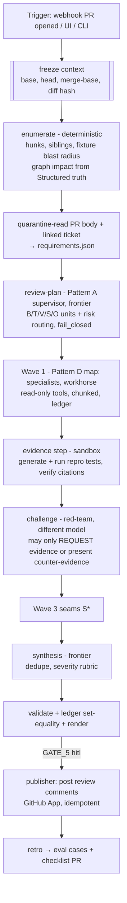
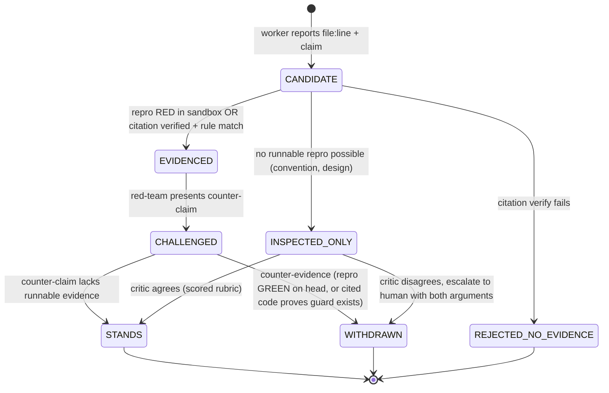

# 03 — Workflows

## 1. Step contract

Mỗi step trong workflow pack được khai báo như dưới. Engine, gateway và policy đọc **cùng một** contract này. Không có chỗ nào để LLM tự quyết luồng điều khiển.

```yaml
# workflows/ticket-to-pr/steps/pbi.yaml
id: pbi
pattern: generator-critic            # supervisor | pipeline | generator-critic | map-reduce
agent: pbi-manifest-writer@3         # Agent Spec trong Registry (có version)
executor: codex                      # copilot | codex (ADR-01); chạy trong Run Cell
model_tier: frontier                 # gateway map tier -> model của provider đã duyệt
escalate_to: null
tools: []                            # quarantined generation: KHÔNG tool
inputs:
  - source-packet@APPROVED           # chỉ nhận artifact đã promote
output:
  artifact: pbi-manifest
  schema: schemas/pbi-manifest.schema.json
validators: [pbi-contract.validate, provenance.check, traceability.check]
repair: { max_attempts: 2 }          # output guard fail -> sửa trong cùng step
critic:
  agent: pbi-critic@1
  executor: copilot                  # khác executor với generator (05 §1.4)
  model_tier: workhorse
  different_vendor: preferred
  signs: reviewed                    # critic ký -> trust REVIEWED
gate: { id: GATE_1, mode: hitl }     # policy có thể nâng lên hotl (§5)
budget: { tokens: 250000, usd: 2.00, wall: 20m }
sandbox: { egress: [] }              # không cần mạng
requires_env_level: L0               # L0 static | L1 compile | L2 unit | L3 integration (07 §3.5)
```

## 2. Pattern catalog

Lấy từ [BDWA], bổ sung **D** từ điểm mạnh anti-leak của v1.

| Pattern | Khi nào dùng | Cơ chế trong Gatehouse | Dùng ở đâu |
|---|---|---|---|
| **A. Supervisor–Specialist** | Kế hoạch phụ thuộc vào khám phá lúc chạy | Supervisor (frontier) **chỉ trả về plan theo schema**. Engine dispatch từng specialist (workhorse) với tool scope hẹp. Supervisor không gọi tool ghi | `review-plan` → các wave review |
| **B. Deterministic handoff pipeline** | Luồng có cấu trúc, lặp lại | Stage cố định, validate schema giữa các stage, không có "planner" | Ticket → PBI → Spec → Plan → Tasks |
| **C. Generator + independent critic** | Output sẽ dẫn tới hành động hoặc quyết định | Critic (model khác) chấm theo rubric và **ký** attestation `reviewed`. Không có chữ ký này thì không promote được | Manifest, patch, finding P1/P2 |
| **D. Map-reduce with ledger** | Input lớn (diff to, nhiều unit) | Enumerate deterministic → chia chunk → worker song song → **set equality** giữa input và output → synthesis | Review diff lớn, legacy coverage |

## 3. Ba workflow viết lại

### 3.1 Ticket → PR (thay cho ticket pipeline 9 stage)

```mermaid
flowchart LR
  subgraph EVID[Evidence - tools ON, no generation]
    I[intake<br/>Tool GW read-only<br/>scale tier]
  end
  I --> Q[quarantine-read<br/>tools OFF, scale<br/>untrusted → structured]
  Q --> FZ[[freeze<br/>source-packet]]
  FZ -->|GATE_0 auto: validator| P[pbi<br/>frontier, tools OFF<br/>+ critic]
  P -->|GATE_1 hitl| S[spec<br/>workhorse + critic]
  S -->|GATE_2 hitl/hotl| PL[plan<br/>frontier]
  PL --> T[tasks<br/>workhorse]
  T -->|GATE_3 hitl/hotl| IM[implement<br/>workhorse, sandbox<br/>TDD, egress: mirror]
  IM --> PATCH[[patch artifact<br/>diff + test evidence]]
  PATCH --> CR[self code-review<br/>= workflow 3.2 on patch]
  CR -->|GATE_4 hitl| PUB[publisher<br/>GitHub App write<br/>branch gatehouse/*<br/>open draft PR]
  PUB --> DOC[publish-docs<br/>Confluence, after merge]
```



Thay đổi so với v1:

| v1 | v2 | Vì sao |
|---|---|---|
| `intake` vừa lấy dữ liệu vừa có thể sinh nội dung | Tách **intake** (lấy dữ liệu, không sinh) và **quarantine-read** (sinh nội dung, không tool) | Dual-LLM, chống injection ngay từ ticket |
| 5 gate ở 5 chỗ cố định | Gate gắn với *rủi ro*: `GATE_0` tự động (validator), GATE_2/3 có thể lên `hotl` khi đủ điều kiện (§5) | Bớt mệt mỏi khi phải duyệt nhiều mà không bớt an toàn |
| `implement` ghi thẳng vào worktree của impl repo | `implement` tạo ra **patch artifact** (diff + log test RED→GREEN). **Publisher** mới là thứ mở PR | Không có đường đi thẳng từ agent tới repo [SGX] |
| `code-review` chạy riêng | Review chính patch của mình bằng workflow 3.2 (Pattern C) | Critic độc lập trước khi người xem |
| Publish Confluence là stage thủ công | `publish-docs` là write step, chỉ chạy sau khi PR merge (webhook) | Tài liệu khớp với code đã thật sự merge |

Autonomy ceiling cho `implement` (policy, **luôn** ép về HITL bất kể có earned autonomy hay không):
- Patch > `autonomy.max_loc` (mặc định 400), hoặc đụng đường dẫn trong `risk-routing.yml` (`auth`, `payment`, `crypto`, `migrations`, `.github/workflows`, `Dockerfile`, `infra/`).
- Thêm dependency mới, hoặc sửa file build/lockfile.
- Xóa test hoặc giảm coverage.

### 3.2 PR Review (thay cho review runtime)

Giữ phần mạnh nhất của v1 (freeze context, enumeration, waves, repro, citations, coverage ledger) và sửa 3 điểm: **repro chạy trong sandbox**, **finding quyết định bằng bằng chứng**, **post comment là write step có gate**.



**State machine của một finding (I11, chống sycophancy):**



Điểm mấu chốt: **lý lẽ không tự đổi được trạng thái**. Chuyển `EVIDENCED → WITHDRAWN` bắt buộc phải có một artifact bằng chứng chạy được. Chuyển trạng thái do *code* quyết định, model không quyết định.

Tool scope theo vai trò:

| Vai trò | Tool | Egress | Tier |
|---|---|---|---|
| enumerate | git (local), graph | none | — (code) |
| review-plan | đọc artifact | none | frontier |
| specialist worker | `repo.read`, `graph.query`, `kb.search` | none | workhorse |
| evidence | `sandbox.exec(test_cmd)`, `repo.write_test_file` (chỉ trong worktree tạm) | package mirror | workhorse |
| red-team | đọc artifact + `repo.read` | none | workhorse (khác vendor nếu có) |
| synthesis | đọc artifact | none | frontier |
| publisher | `github.post_review` | GitHub API (qua gateway) | — (code) |

### 3.3 Legacy Test Coverage

Giữ nguyên 7 stage của v1. Thay đổi:
- `implement-tests` và `verify-coverage` chạy trong sandbox (lệnh build "clean + coverage + test trong một lần gọi" vẫn giữ).
- `verify-coverage` là code deterministic (parse JaCoCo/Istanbul), **không phải agent**. Status `TESTED/EXCLUDED/DELETED` do code ghi.
- Test sinh ra là patch artifact, đi qua Publisher như 3.1.
- Eval suite riêng: **mutation testing** (PIT/Stryker) trên test sinh ra, để đo test có thật sự bắt được lỗi hay không, thay vì chỉ đo coverage.

## 4. Ví dụ trace của một PR review

Cách span hiển thị trong web console (minh họa, số liệu lấy từ budget mặc định):

```
run pr-review#812  budget $3.00  used $1.37  tokens 412k  cache-hit 38%
├─ freeze                         0.4s
├─ enumerate                      2.1s   hunks=146 units=9
├─ quarantine-read  [scale]       3.0s   $0.01  guard: 1 injection pattern flagged (PR body)
├─ review-plan      [frontier]   18.2s   $0.29
├─ wave1 ×9         [workhorse]  71.5s   $0.62  ledger 146/146 ✓
├─ evidence (sandbox)            94.0s          repro: 3 RED, 1 GREEN
├─ challenge        [workhorse]  22.7s   $0.14  2 STANDS, 1 WITHDRAWN (repro GREEN)
├─ seams            [workhorse]  15.3s   $0.11
├─ synthesis        [frontier]   12.9s   $0.20
├─ validate+render                1.2s   citations 27/27 ✓
├─ GATE_5 (human wait)          41m 12s  approver=@me  decision=approve
└─ publisher                      1.8s   7 comments, idempotency=pr812-h9f3
```

## 5. Earned autonomy (HITL → HOTL)

Autonomy là một **policy dựa trên số liệu**, không phải cấu hình tay. Một gate (theo từng workflow và từng repo) được nâng từ `hitl` lên `hotl` chỉ khi **tất cả** điều kiện sau đúng trong cửa sổ trượt (mặc định 30 run gần nhất):

| Điều kiện | Ngưỡng mặc định |
|---|---|
| Tỷ lệ approve không sửa | ≥ 95% |
| Edit distance trung vị khi có sửa | ≤ 5% |
| Không có sự cố (finding bị bỏ sót, revert) liên quan | 0 |
| Offline eval của registry version hiện tại | PASS |
| Không chạm autonomy ceiling (§3.1) | bắt buộc |

`hotl` nghĩa là: artifact tự promote, người được thông báo, có **cửa sổ veto** (mặc định 30 phút; publisher chỉ chạy sau cửa sổ này). Khi xảy ra bất kỳ điều sau, gate **tự hạ về `hitl`**: một veto, một sự cố, eval fail, đổi model, đổi agent spec. Kill switch toàn cục: `gatehouse freeze` dừng mọi run, thu hồi mọi token và hạ mọi gate về `hitl`.

Mức độ tương ứng trên thang [BDWA]:

| Mức | Gatehouse |
|---|---|
| L2 Grounded copilot | IDE chat hỏi Gatehouse qua MCP (read-only) |
| L3 Bounded task agent + HITL | Mặc định cho mọi workflow |
| L4 Fleet + HOTL | Chỉ ở gate đã *earned*, luôn nằm dưới autonomy ceiling |
