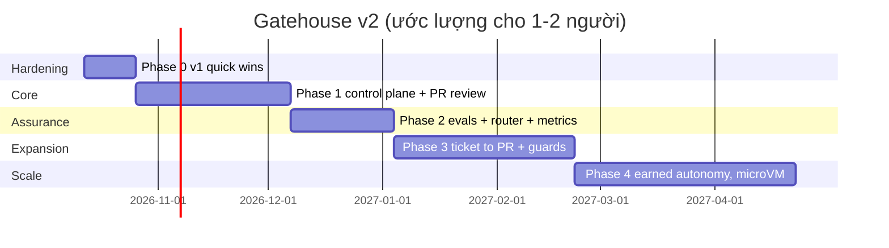

# 04 — Lộ trình, tech stack, KPI, trade-off

## 1. Cấu trúc repo đề xuất

```
gatehouse/
├── packages/
│   ├── engine/            Workflow Engine: event store, state machine, scheduler, projections
│   ├── gates/             Gate Service + web approval API (signed events)
│   ├── artifacts/         CAS + attestations + trust levels + `gatehouse verify`
│   ├── gateway-llm/       LLM Gateway: routing tiers, budgets, caching, OTel gen_ai spans
│   ├── gateway-tools/     MCP Tool Gateway: capability tokens, schema, OPA, taint, idempotency
│   ├── identity/          Identity Broker: run JWT, GitHub App tokens, keychain
│   ├── firewall/          Content Firewall: envelope, injection scan, redact, output guards
│   ├── sandbox/           Runner: docker+gVisor, egress proxy, per-step network policy
│   ├── harness/           Executor adapters: copilot-cli, codex-cli (+ probe version/capability)
│   ├── cells/             Run Cell manager: materializer, per-cell network + sidecar, scheduler, gc
│   ├── mcp-proxy/         BYO-MCP proxy: tool manifest filter, DLP, taint, audit
│   ├── dlp/               PAN/Luhn/track/secret detectors, test-PAN allowlist
│   ├── knowledge/         graph scanners (từ v1 Extended), kb index, memory
│   ├── evals/             suites, mutation seeding, judges, reports
│   └── console/           Web console (dashboard, gates, traces, settings - v1 §07 schema-driven)
├── registry/              ⟵ versioned, change = PR + eval
│   ├── workflows/         ticket-to-pr/, pr-review/, legacy-tests/  (DAG + step contracts)
│   ├── agents/            <name>/agent.yaml + prompt.md  (Agent Spec trung lập)
│   ├── schemas/           source-packet, pbi-manifest, review, patch, finding...
│   ├── policies/          egress.rego, tools.rego, autonomy.rego, data.rego, budget.rego (+ tests)
│   └── evals/             golden/, mutations/, sycophancy/, injection/
├── compiled/              GENERATED: .github/agents, .codex, Claude subagents (từ registry/agents)
└── docs/
```

## 2. Lộ trình

> **Cập nhật:** thứ tự giao hàng đổi sang *Host mode trước, Sandbox sau*. Xem [08-delivery-host-then-sandbox.md](08-delivery-host-then-sandbox.md). Phase 1 bên dưới tương ứng với Version A (A0–A6) chạy trên host; phần Run Cell, build image và Kata chuyển sang Version B (B0–B4).

Đi theo nguyên tắc **strangler**: mỗi phase đều chạy được và có giá trị riêng. **Workflow đầu tiên chuyển sang là PR Review**, vì nó read-only (rủi ro thấp nhất), giá trị cao, và v1 đã có runtime tốt để port.

### Phase 0 — Hardening v1 (1–2 tuần, nếu đang chạy v1)
Đây là các quick win, sửa những lỗ hổng ❌ trong 01 §2 mà chưa cần kiến trúc mới.

| Việc | Sửa lỗ hổng | DoD |
|---|---|---|
| Chạy executor CLI (copilot/codex) và `review-repro` **trong container** (dùng lại `sandbox.js`) với `--network` chỉ qua proxy allowlist | G2, G5 | Test: process trong container không đọc được `~/.ssh`, `.env`; `curl example.com` bị chặn |
| Gate approval chuyển ra **SQLite do webapp quản lý** (POST từ UI có CSRF), bỏ file marker; validator đọc từ DB | G1 | Tạo `gates/GATE_1.approved` bằng tay → pipeline **không** đi tiếp |
| Đổi `GITHUB_TOKEN` PAT sang **GitHub App** installation token, TTL 1h, scope repo | G3 | `.env` không còn token GitHub |
| `llm-gateway.js` ghi token/cost cho mỗi call → `cost.jsonl` + OTel span | G8, G9 | Báo cáo `cost per review run` |
| Red-team: chỉ cho phép `WITHDRAWN` khi có repro GREEN hoặc citation phản chứng | G6 | Unit test của `validateRebuttal` |

### Phase 1 — Core control plane (4–6 tuần) → MVP
Gồm `engine`, `artifacts`, `gates`, `cells` (Run Cell + materializer), `gateway-llm` (BYOK cho Copilot + Codex), `mcp-proxy` (chỉ tool đọc), `dlp`, `harness` (cả 2 adapter), console tối thiểu. Port **PR Review** (03 §3.2) lên.

Thêm **Env Synthesis cho `java-maven`** (detect → `env.yaml` → build image → verify L1/L2 → GATE_ENV; chưa có Env Doctor), vì PR review cần nó để chạy repro ([07](07-environment-synthesis.md)). Env Doctor, mức L3 và các stack khác làm ở Phase 2–3.

PCI không phải tính năng làm sau. Clean room (DLP preflight + DLP ở MCP + DLP ở gateway), chặn `pci.cde_cidrs` và audit hash chain **đều nằm trong Phase 1**.

**DoD**
- `gatehouse run pr-review --repo o/r --pr N` chạy hết tới GATE_5; crash giữa chừng (kill -9) xong resume đúng step.
- Bảng 02 §5: có test tự động cho từng dòng Network, Secrets, Gates, Artifacts, Workflow (chaos test: agent spec cố tình gọi ra ngoài, đọc env, ghi vào event store → đều bị chặn và ghi audit).
- Mọi span có trên timeline. Có `cost_per_completed_workflow`.

### Phase 2 — Assurance (3–4 tuần)
Gồm `evals` + metrics dashboard + router theo tier.

**DoD**
- Suite `pr-review` có ≥ 30 PR với bug được cấy (mutation) và ≥ 30 PR lịch sử có comment của người, kèm baseline recall/precision.
- Suite `sycophancy` và `injection` chạy trong CI. Một PR sửa `registry/agents/**` mà làm giảm điểm vượt ngưỡng thì **bị chặn merge**.
- Router: chuyển worker sang tier `workhorse` và plan/synthesis sang `frontier`, báo cáo được chênh lệch chi phí và chất lượng so với chạy một model.

### Phase 3 — Ticket → PR + full guard stack (5–7 tuần)
Gồm `firewall`, `identity` đầy đủ, Policy Engine (OPA), Publisher, `knowledge` (graph scanners + kb index), memory có người duyệt. Port **Ticket → PR** (03 §3.1) và **Legacy Tests** (03 §3.3).

**DoD**
- Ticket có chỉ dẫn ẩn (chữ trắng, HTML comment) → không có tool call ngoài scope, output không chứa URL lạ, guard trip được ghi lại.
- `implement` vượt autonomy ceiling → luôn dừng ở HITL kèm lý do policy.
- PR do Gatehouse mở chỉ nằm trên `gatehouse/*`, ở dạng draft, có attestation link.

### Phase 4 — Scale & earned autonomy (liên tục)
- Earned autonomy (03 §5), kill switch, tự hạ cấp khi có sự cố.
- (Tùy chọn, ngoài phạm vi ADR-02) Team mode: Postgres, SSO, approver theo CODEOWNERS.
- MicroVM (Firecracker/Kata) cho workload không tin cậy cao. Cân nhắc A2A nếu có agent ngoài cần tham gia.
- Security flywheel [CSW]: nguồn threat intel → cập nhật policy; retro → eval case tự động mở PR.



## 3. Tech stack đề xuất

| Lớp | Lựa chọn | Lý do / phương án thay thế |
|---|---|---|
| Ngôn ngữ | TypeScript / Node 22 | Liên tục với v1 (Node). Dùng lại được `pbi-contract`, `review-contract`, `llm-gateway` |
| Event store | SQLite (`better-sqlite3`, WAL) → Postgres | Local-first. Thay bằng Temporal khi cần nhiều worker trên nhiều máy |
| Policy | OPA/Rego qua `@open-policy-agent/opa-wasm` | Đúng chuẩn [BDWA] Ring 3. Phương án khác: Cedar |
| Sandbox | Docker + gVisor `runsc` (Linux/WSL2) | Phương án khác: Firecracker/Kata. Windows host thì chạy trong WSL2 như v1 §07-B |
| Egress proxy | Envoy hoặc proxy CONNECT tự viết có allowlist SNI | Log mọi lần deny để làm *telemetry-proven* egress |
| Package mirror | Verdaccio (npm) / Nexus OSS / devpi | Pull-through có allowlist, không fetch URL tùy ý |
| LLM gateway | Tự viết (nâng từ `llm-gateway.js`) hoặc LiteLLM proxy | Cần giữ key, đếm budget, map tier |
| Executors | Copilot CLI (BYOK Mode G, `COPILOT_OFFLINE=true`) + Codex CLI (`model_providers` → gateway), agent-in-sandbox | Adapter interface 05 §1.3. Generator và critic dùng hai executor khác nhau |
| MCP | BYO-MCP (server của user cho Jira/Confluence Server/DC) phía sau MCP Proxy | Proxy viết bằng `@modelcontextprotocol/sdk` (client stdio ↔ server streamable HTTP) |
| DLP | Detector tự viết (Luhn + IIN + ngữ cảnh) + bộ luật gitleaks | Có thể thêm Presidio nếu cần NER |
| Tracing | OpenTelemetry JS + GenAI semconv; UI trong console; export OTLP | Langfuse / Phoenix / Grafana Tempo |
| Identity | GitHub App + `jose` (run JWT) + OS keychain (`keytar` / libsecret) | OAuth 3LO cho Atlassian Cloud |
| Console | Giữ webapp v1 (schema-driven settings §07) + thêm Runs, Gates, Traces, Evals | Bind 127.0.0.1, CSRF, passkey cho approve |

## 4. KPI

| Loại | Metric | Ghi chú |
|---|---|---|
| **North-star** | `cost_per_completed_workflow` (USD/PR review, USD/ticket→PR) | [BDWA]: thay cho "minutes saved" |
| Hiệu quả | `straight_through_rate` (tỷ lệ run qua gate không phải sửa), `cycle_time` (trigger → published) | Theo dõi xu hướng, không đặt chỉ tiêu cứng |
| Chất lượng | `finding_precision` (tỷ lệ finding được người chấp nhận), `finding_recall` trên mutation suite, `escaped_defects` (bug lọt sau review) | Recall trên mutation là chỉ số "thật" nhất |
| An toàn | `guard_trips{check}`, `policy_denies`, `egress_denies`, `budget_exceeded`, số gate bị hạ cấp | Tăng đột biến thì điều tra, không phải thành tích |
| Niềm tin | `gate_reject_rate`, `edit_distance_at_gate`, số gate đã earned `hotl` | Đầu vào của earned autonomy |

## 5. Trade-off chấp nhận có chủ đích

Theo tinh thần [SGX]: *"Before rebuilding a control, ask what it actually protects."*

| Trade-off | Lý do chấp nhận | Điều vẫn giữ được |
|---|---|---|
| Local-first, một máy, SQLite | Dùng cá nhân/nhóm nhỏ; đơn giản là một tính năng | Interface của event store cho phép đổi sang Postgres/Temporal |
| Spec/plan/tasks *không bắt buộc* đi qua workflow (dev có thể tự viết) | Paved road lan ra vì *nhanh hơn*, không phải vì bị ép | **Đường duy nhất để Gatehouse ghi vào repo là Publisher + gate** |
| Jira/Confluence Server dùng PAT của service account | Server/DC không hỗ trợ token ngắn hạn | PAT chỉ nằm ở gateway/keychain; service account có quyền tối thiểu; audit mọi call |
| gVisor thay vì microVM ở giai đoạn đầu | Chạy được trên WSL2/laptop, overhead thấp | Đã có lộ trình microVM (Phase 4); network/secret control không phụ thuộc runtime |
| Content firewall dạng heuristic + model tier scale (không phải sản phẩm thương mại) | Chi phí và độ phức tạp | Không phụ thuộc vào firewall: taint + no-write-when-tainted + gate vẫn chặn được hậu quả |
| Review vẫn là `INSPECTED_ONLY` khi không có repro | Không phải lỗi nào cũng repro được | Finding loại này phải qua critic + người, không tự động post |

## 6. Câu hỏi mở

Đã chốt ADR-01..04 (xem [README](README.md#quyết-định-đã-chốt-06102026)). Còn lại:

1. **Impl stack** của các repo: Java/Maven như ví dụ trong v1? Ảnh hưởng tới image executor, repro và mutation tool (PIT hay Stryker).
2. **LLM upstream đã được duyệt** (TPSP) là gì: Azure OpenAI, Anthropic enterprise, Bedrock, hay chỉ model tự host? Ảnh hưởng tới routing table và tier `private`.
3. Các điểm cần **QSA xác nhận** trong [06 §8](06-pci-dss.md).
4. Có muốn mình **scaffold Phase 1** ngay trong repo này không?
