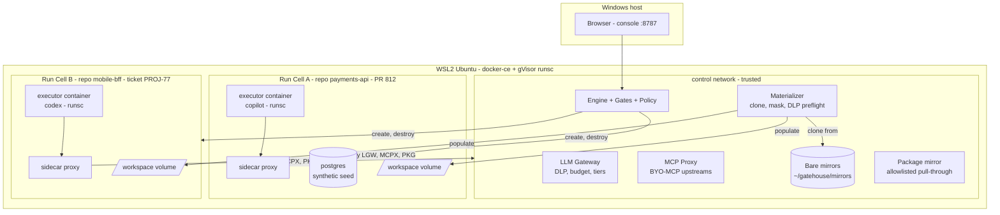
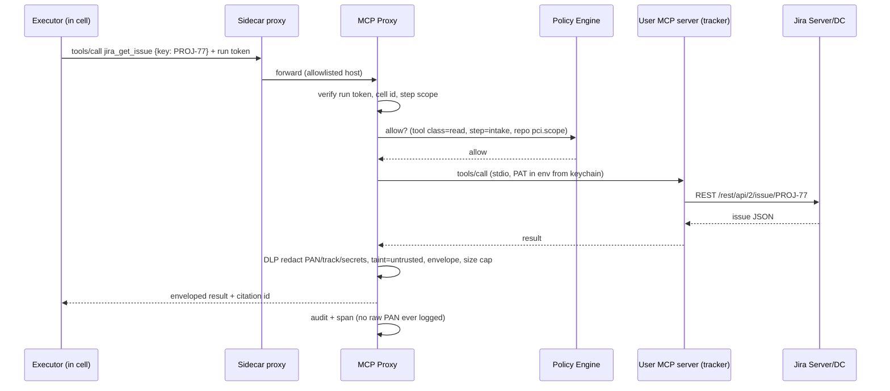

# 05 — Executors, Run Cells & BYO-MCP (theo quyết định đã chốt)

## 0. Quyết định (ADR)

| ADR | Quyết định | Hệ quả thiết kế |
|---|---|---|
| **ADR-01** | Executor là **Copilot CLI + Codex CLI**. Gatehouse không tự viết agent loop | Mọi step có agent đều dùng pattern **agent-in-sandbox**. `harness` chỉ còn là 2 adapter. Bỏ Claude Agent SDK khỏi stack |
| **ADR-02** | **Local, một người dùng**, nhưng chạy được **nhiều repo song song**, mỗi run cô lập source riêng | SQLite, không SSO. Thêm khái niệm **Run Cell** (§2) và scheduler |
| **ADR-03** | Jira/Confluence **Server/DC**. **User tự setup MCP** cho executor | Gatehouse không ship MCP server. Có **BYO-MCP**: MCP của user chạy phía sau **MCP Proxy** (§3) |
| **ADR-04** | Tuân thủ **PCI-DSS** | Clean-room, DLP ở mọi lối vào, LLM bắt buộc đi qua gateway với repo trong scope, retention audit 12 tháng, người review thứ hai. Xem [06-pci-dss.md](06-pci-dss.md) |

## 1. Executors chạy trong cell

### 1.1 Copilot CLI: hai chế độ

| | **Mode G: qua Gateway (BYOK)** — mặc định, *bắt buộc* với repo trong PCI scope | **Mode H: model do GitHub host** (subscription Copilot) |
|---|---|---|
| Cấu hình trong cell | `COPILOT_PROVIDER_TYPE=openai\|anthropic`<br>`COPILOT_PROVIDER_BASE_URL=http://llm-gw:4000/...`<br>`COPILOT_PROVIDER_API_KEY=<run token>` (**không phải** key thật)<br>`COPILOT_MODEL=tier-workhorse`<br>`COPILOT_OFFLINE=true` | `COPILOT_GITHUB_TOKEN=<fine-grained PAT>` chỉ có quyền **Copilot Requests**, không có quyền repo nào |
| Traffic đi đâu | Chỉ tới LLM Gateway. **Không** liên lạc GitHub, telemetry tắt | Thẳng tới các host API Copilot (đã nằm trong allowlist của egress proxy) |
| Gateway soát được prompt? | ✅ DLP, budget, trace, routing theo tier | ❌ TLS đi thẳng, chỉ đếm được số request |
| Mất gì | `/delegate`, GitHub MCP built-in, code search (vốn không muốn agent dùng mấy thứ này) | — |
| Cho phép với | Mọi repo | Chỉ repo `pci.scope: out`, và vẫn phải qua clean-room (06 §3) |

> Mode G làm tốt hơn yêu cầu "sandbox không thấy secret": thứ cell cầm chỉ là **run token** (JWT ngắn hạn, gắn với run). Gateway verify token này rồi mới gắn key thật của upstream provider.

### 1.2 Codex CLI
- Materializer sinh `config.toml` trong `CODEX_HOME` riêng của cell, mount read-only. *Không* đặt trong repo, vì Codex bỏ qua `model_providers` khi khai báo ở project scope.

```toml
model = "tier-workhorse"
model_provider = "gatehouse"
approval_policy = "never"            # Gatehouse là nơi quyết định, không phải prompt trong CLI
sandbox_mode = "workspace-write"     # lớp phụ; ranh giới thật là cell (gVisor có thể không hỗ trợ Landlock -> fallback)

[model_providers.gatehouse]
name = "Gatehouse LLM Gateway"
base_url = "http://llm-gw:4000/v1"
env_key = "GATEHOUSE_RUN_TOKEN"
wire_api = "responses"

[mcp_servers.tracker]                # BYO-MCP qua proxy, xem §3
url = "http://mcp-proxy:7000/cells/<cell-id>/tracker"
```

- Chạy bằng `codex exec` (non-interactive). Output bắt buộc ghi vào `/out/candidate.json`. **Adapter không bao giờ coi nội dung chat là sự thật**, chỉ đọc file và validate schema.

### 1.3 Adapter contract

```ts
interface ExecutorAdapter {
  id: 'copilot' | 'codex';
  // biến step contract thành lệnh chạy cụ thể trong cell
  render(step: StepContract, cell: CellInfo): { argv: string[]; env: Record<string,string>; files: MountedFile[] };
  // đọc kết quả: chỉ file trong /out, không parse transcript
  collect(outDir: string): CandidateBundle;     // { artifact, transcriptRef, usage }
  supports: { byok: boolean; mcpHttp: boolean; toolAllowlist: boolean; jsonOutput: boolean };
}
```

| Gatehouse tool scope | Copilot CLI | Codex CLI |
|---|---|---|
| `tools: []` (quarantined) | `--deny-tool` cho mọi tool built-in, không cấu hình MCP | `sandbox_mode=read-only`, không có `mcp_servers` |
| read-only repo + MCP đọc | `--allow-tool` cho các tool đọc file + MCP proxy endpoint (proxy chỉ expose tool đọc) | `read-only` + `mcp_servers` trỏ vào proxy |
| implement (ghi worktree, chạy test) | cho phép write/shell **trong cell** | `workspace-write` |

> Các flag này là **lớp phụ**. Ranh giới thật vẫn là cell, gateway và proxy (02 §5). Tên flag và option có thể đổi theo version của CLI. Adapter phải có bước `probe` để kiểm tra version/capability trước khi chạy (kế thừa `probe-executors.js` của v1 Extended).

### 1.4 Đa dạng executor = critic độc lập
Policy mặc định: **generator và critic dùng hai executor khác nhau, đi tới hai upstream model khác vendor**. Ví dụ generator là Codex → model OpenAI, critic là Copilot (BYOK) → model Anthropic. Như vậy Pattern C có độc lập thật, lỗi của hai bên ít tương quan với nhau.

### 1.5 File instruction trong repo là dữ liệu không tin cậy ⚠️
Copilot CLI tự đọc `.github/copilot-instructions.md`, `.github/agents/**`, `AGENTS.md`. Codex đọc `AGENTS.md` theo từng cấp thư mục. Repo còn có thể có `.vscode/mcp.json`. **Trong PR review, tác giả PR kiểm soát được các file này**, nên đây là một kênh prompt injection trực tiếp. Họ cũng có thể khai báo MCP server độc trong đó.

Control (materializer, nằm ngoài agent):
- **Che (mask)** các đường dẫn sau trong worktree của cell bằng bản Gatehouse đã compile (mount read-only, đè lên): `AGENTS.md` (mọi cấp thư mục), `.github/copilot-instructions.md`, `.github/agents/**`, `.github/instructions/**`, `.codex/**`, `.copilot/**`, `.vscode/mcp.json`, `.mcp.json`.
- Nội dung gốc của các file đó (nếu PR có sửa) chỉ đưa cho agent **dưới dạng diff đã gắn taint**, để review như code bình thường.
- Đặt `HOME` và `CODEX_HOME` của cell vào thư mục tạm do Gatehouse sinh. Không bao giờ dùng config của user trên host.

Thêm vào threat model (02 §9): **T11, Instruction-file injection** → mask + taint + eval case trong suite `injection`.

## 2. Run Cells: chạy nhiều repo song song, cô lập source

### 2.1 Topology



### 2.2 Một cell gồm những gì

| Thành phần | Chi tiết |
|---|---|
| **Network** | Docker network `--internal` riêng cho mỗi cell (không có default gateway). Container trong cell **không thấy** cell khác hay host |
| **Sidecar proxy** | Là thành phần duy nhất của cell gắn vào cả cell-net và control-net. Allowlist lấy từ policy của step: `llm-gw`, `mcp-proxy/cells/<id>`, `pkg-mirror` (khi cần). Chặn RFC1918/link-local/host. Mọi lần deny đều được log |
| **Executor container** | Image `gatehouse-exec-<stack>` (node + copilot + codex + JDK/Maven…). Runtime `runsc`. User non-root, `--cap-drop=ALL`, `no-new-privileges`, rootfs read-only. Giới hạn `--pids-limit`, `--cpus`, `--memory` |
| **Workspace volume** | Volume riêng của cell, *không* bind mount từ thư mục repo của user. Trong đó: `/work` (worktree), `/out` (candidate), `/home/agent` (tmp) |
| **Service containers** | DB hoặc service phụ, chỉ seed từ **dữ liệu synthetic** (PCI 6.5.5), nằm trên cell-net |
| **Identity** | Run JWT gắn với `cell_id + step_id`, TTL = timeout của step |

### 2.3 Materializer (trusted, chạy ở control side)
1. `git fetch` vào **bare mirror** của repo, dùng credential của host qua Identity Broker. Mirror **không bao giờ** được mount vào cell.
2. `git clone --no-local --filter=blob:none <mirror> <volume>/work` rồi checkout đúng SHA đã freeze. Cell có repo riêng, không share object store, không thấy branch hay repo khác.
3. Áp dụng **path exclusions** theo repo (06 §3: file không được đưa cho LLM) bằng sparse-checkout âm hoặc xóa. *Thứ không có trong cell thì không thể bị gửi đi.*
4. **Mask instruction files** (§1.5).
5. **DLP preflight** trên toàn bộ file sẽ lộ ra (PAN/Luhn, track data, secret theo luật gitleaks). Có hit ngoài allowlist test-PAN → step bị `BLOCKED`, người quyết định thêm exclusion hay sửa repo (fail closed).
6. Tính hash của "cell manifest" (danh sách file và hash) và ghi vào event log. Có thể audit lại đúng những gì agent đã thấy.

### 2.4 Cache build an toàn khi chạy song song
- Cache dùng chung giữa các cell là **kênh nhiễm chéo** (cache poisoning). Vì vậy:
  - Mỗi repo có một lớp cache **read-only** (lower layer), do job tin cậy `warm-cache` dựng từ nhánh `main`.
  - Mỗi cell có một lớp **upper** riêng (overlayfs hoặc volume tạm), bị xóa khi cell kết thúc.
  - Dependency mới chỉ tải được qua **package mirror** có allowlist, không tải thẳng từ internet.
- Cache **không bao giờ** được share giữa hai repo khác nhau.

### 2.5 Scheduler
- `slots = min(cpu_cores / cpu_per_cell, ram / ram_per_cell)` (mặc định cell = 2 CPU, 4 GB). Cấu hình trong Settings.
- **Mỗi repo có giới hạn riêng** (mặc định 2 cell cùng lúc). Mỗi `(repo, SHA, workflow)` chỉ có một run active (idempotent trigger).
- **Rate limit theo executor/provider**: số request đồng thời tới gateway theo từng upstream, quota premium request của Copilot (Mode H).
- Ưu tiên: run đang chờ người (đã qua gate) được chạy trước run mới.
- `gatehouse ps | logs <cell> | kill <cell> | gc` (TTL mặc định 24h với cell đã dừng; workspace bị xóa hẳn).

### 2.6 Cái gì được share, cái gì không

| Share giữa các cell | Không bao giờ share |
|---|---|
| Image executor (read-only), lớp cache read-only của *cùng repo*, LLM Gateway, MCP Proxy (endpoint tách theo cell), package mirror | Workspace, network, DB, `HOME`/config của CLI, run token, credential, cache upper, mirror git |

### 2.7 Host Windows + WSL2
- Dùng **docker-ce trong WSL2** (không dùng Docker Desktop) để cài được gVisor `runsc` làm runtime. Bật `networkingMode=mirrored` để trình duyệt Windows mở được console.
- Fallback khi buộc phải dùng Docker Desktop: runtime `runc` đã hardening (seccomp mặc định, userns-remap, cap-drop, rootfs read-only). Ghi rõ trong Settings rằng chế độ này **không** có lớp kernel isolation (trade-off).
- Mọi state (`~/gatehouse/`, mirrors, volumes) nằm trên ext4 của WSL, không đặt ở `/mnt/c` (kế thừa v1 §07-B).

## 3. BYO-MCP: Jira/Confluence Server/DC

### 3.1 Nguyên tắc
User vẫn **tự chọn và tự cấu hình** MCP server (vd. server Python FastMCP của v1, hoặc mcp-atlassian). Nhưng executor **không** kết nối thẳng tới server đó. Gatehouse chạy nó ở control side, làm *upstream* của **MCP Proxy**, rồi expose cho từng cell một endpoint đã lọc.

```yaml
# config.local.yaml (machine scope) - cú pháp giống mcp.json
mcp:
  servers:
    tracker:
      command: uv
      args: [run, --directory, ~/work/repos/jira-mcp, server.py]
      env:
        JIRA_URL: https://jira.corp.local
        JIRA_PAT: { secret: JIRA_PAT }          # lấy từ keychain, không ghi file
        CONFLUENCE_URL: https://confluence.corp.local
        CONFLUENCE_PAT: { secret: CONFLUENCE_PAT }
      tools:                                     # manifest bắt buộc - tool không khai báo = DENY
        read:  [jira_get_issue, jira_search, confluence_get_page, confluence_search, investigate_issue]
        write: [jira_add_comment, jira_transition, confluence_create_page]   # chỉ Publisher dùng
        deny:  ["*delete*", jira_update_issue]
      dlp: strict                                # PAN/track/secret redaction trên mọi kết quả
```

### 3.2 Luồng



- `tools/list` mà cell nhìn thấy là kết quả **đã lọc** theo step: step đọc không bao giờ *thấy* tool ghi.
- Tool trong manifest có thay đổi (server được update, thêm tool mới) → mặc định DENY cho tới khi user phân loại trong Settings. Settings có nút **"Inspect tools"**: liệt kê tool, đề xuất phân loại dựa trên tên/mô tả, user xác nhận.
- Step `intake` (deterministic) cũng gọi qua chính proxy này với vai trò MCP client. Chỉ có **một** đường tới Jira/Confluence.
- Write (comment, transition, publish trang) chỉ đến từ Publisher, với artifact `APPROVED` và `idempotency_key`.
