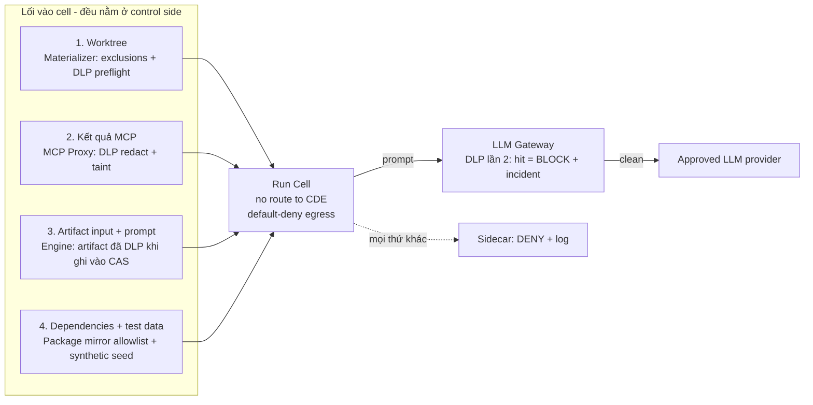

# 06 — PCI-DSS (v4.0.1) trong Gatehouse

> Phần này là **thiết kế hỗ trợ tuân thủ**, không phải ý kiến của QSA. Phạm vi và cách diễn giải từng requirement phải được QSA/ISA của tổ chức xác nhận (xem §8).

## 1. Chiến lược: giữ Gatehouse và LLM provider *ngoài* CDE scope

Câu hỏi cốt lõi: **account data (PAN, SAD) có bao giờ đi vào Gatehouse hay tới LLM provider không?** Nếu chứng minh được là *không*, thì Gatehouse, máy dev và các LLM provider đứng ngoài CDE. Lúc đó PCI chủ yếu áp vào phần *quy trình phát triển phần mềm* (Req 6), *quản lý tài khoản* (Req 7/8), *log* (Req 10) và *bên thứ ba* (Req 12.8).

Thiết kế dựa trên 3 điều:
1. **Clean room**: mọi thứ đi *vào* cell đều qua DLP ở lối vào. Cell không có route tới bất kỳ nguồn account data nào.
2. **Bằng chứng liên tục** [CSW]: mỗi lần DLP quét, mỗi lần egress bị chặn đều được ghi. Việc "không có CHD đi ra" được chứng minh bằng telemetry, không chỉ là một câu viết trong tài liệu.
3. **Lớp thứ hai ở cửa ra**: LLM Gateway soát lại mọi prompt (Mode G). Với repo trong scope, đây là lý do Mode G là **bắt buộc**.

## 2. Phân loại dữ liệu

| Lớp | Ví dụ | Quy tắc |
|---|---|---|
| **SAD** | Track data, CVV2/CVC2, PIN/PIN block | **Không bao giờ** được vào cell, artifact, trace hay log, kể cả khi đã mã hóa (Req 3.3.1). DLP chặn ngay, fail closed |
| **PAN** | 13–19 chữ số, qua Luhn, có IIN hợp lệ | Không vào cell. Trong kết quả MCP thì thay bằng `[PAN:<sha256-8>]`. Trong file của repo thì `BLOCKED` |
| **Test PAN** | Số test công bố của các brand (vd. `4111 1111 1111 1111`) | Allowlist tường minh trong `pci.test_pan_allowlist`. Ngoài danh sách này thì tính là PAN thật |
| **Secrets / key material** | `.jks`, `.p12`, `.pem`, key HSM/KMS, password | Mặc định nằm trong path exclusion. Bị phát hiện → `BLOCKED` |
| **Source code, ticket** | Code của hệ thống trong CDE, bug report | Cho phép tới provider *đã duyệt* (§5), sau khi qua DLP |

## 3. Clean room: 4 lối vào cell



- **Lối 1, worktree**: `pci.path_exclusions` theo repo (vd. `**/fixtures/prod-*`, `**/*.jks`, `docs/incidents/**`). Preflight quét mọi file sẽ lộ ra. Không *tự sửa* file code (vì làm đổi nghĩa); có hit thì `BLOCKED` và báo người.
- **Lối 2, MCP**: Jira/Confluence là nơi PAN thường lọt vào nhất (bug report dán log, ảnh chụp màn hình). MCP Proxy redact mọi kết quả. Ảnh đính kèm chỉ được transcribe trong cell `scale` sau khi OCR + DLP; ảnh không qua được DLP thì đánh dấu `INACCESSIBLE` (giữ hành vi của v1).
- **Lối 3, artifact**: CAS chạy DLP **khi ghi** (đây là thêm một lớp; nội dung vốn đã sạch từ lối 1–2).
- **Lối 4, dữ liệu chạy test**: DB của cell chỉ seed từ synthetic data. Cell **không có** connection string hay route tới DB thật (Req 6.5.5). Sidecar luôn chặn `pci.cde_cidrs`, **bất kể** policy của step nói gì.

### Bộ phát hiện DLP (tối thiểu)
- PAN: regex 13–19 chữ số (cho phép khoảng trắng/gạch ngang) → **Luhn** → kiểm tra IIN → ngữ cảnh (từ khóa `card`, `pan`, `cc`, `visa`…) để chấm điểm.
- Track 1/2 (`%B…^…^`, `;…=…?`), CVV theo ngữ cảnh, PIN block.
- Secret: bộ luật gitleaks + entropy.
- Mọi hit chỉ được log ở dạng `{detector, location, hash}`, **không bao giờ** log giá trị.

## 4. Ma trận policy theo `pci.scope` của repo

Khai báo trong team config: `repos[].pci.scope: cde | connected | out`.

| | `cde` (code của system component trong CDE) | `connected` | `out` |
|---|---|---|---|
| Executor mode (05 §1.1) | **G** | **G** | G hoặc H |
| Upstream LLM | Chỉ provider có `tpsp.approved: true` (§5) hoặc tier `private` | Provider đã duyệt | Bất kỳ provider đã cấu hình |
| DLP preflight | strict, fail-closed | strict | PAN + secret |
| Path exclusions | Bắt buộc, có người review | Khuyến nghị | Tùy chọn |
| Earned autonomy (03 §5) | Chỉ áp cho step read-only. **Gate implement/publish luôn HITL** | GATE_1–3 | Theo mặc định |
| Người review PR thứ hai | **Bắt buộc**: CODEOWNER ≠ người khởi tạo run | Bắt buộc | Khuyến nghị |
| Retention audit | 12 tháng (3 tháng online) | 12 tháng | 90 ngày |
| Transcript/prompt lưu trong CAS | 90 ngày, rồi xóa hẳn | 90 ngày | 30 ngày |

## 5. LLM provider là bên thứ ba (Req 12.8)

```yaml
# team config
llm:
  providers:
    - id: azure-oai-sg
      type: azure
      base_url: https://<res>.openai.azure.com
      key: { secret: AZURE_OAI_KEY }
      tpsp:
        approved: true
        agreement_ref: "MSA-2026-014"      # hợp đồng/DPA
        region: southeastasia
        data_retention: zero               # hoặc abuse-monitoring opt-out
        training_on_inputs: false
        reviewed_at: 2026-09-01             # due diligence định kỳ (12.8.3/12.8.4)
    - id: local-vllm
      type: openai
      base_url: http://vllm.local:8000/v1
      tier: private
      tpsp: { approved: true, self_hosted: true }
  tiers:
    frontier:  [azure-oai-sg:gpt-x, anthropic-ent:opus-x]
    workhorse: [anthropic-ent:sonnet-x, azure-oai-sg:gpt-x-mini]
    scale:     [local-vllm:qwen-x]
```

- Gateway **từ chối** route một request của repo `cde`/`connected` tới provider không có `tpsp.approved: true`. Request bị chặn có ghi lý do.
- Settings có trang **TPSP inventory**: provider, hợp đồng, region, ngày review gần nhất, cảnh báo khi quá hạn review. Nội dung này dùng để giao cho QSA (12.8.1–12.8.5).
- Copilot ở Mode H (model do GitHub host) **chỉ** được dùng với repo `out`. Nếu tổ chức muốn dùng cho repo trong scope thì GitHub phải được đưa vào TPSP inventory, và vẫn thiếu lớp DLP thứ hai ở gateway (trade-off phải được QSA chấp nhận).

## 6. Map requirement → control

| Req (v4.0.1) | Nội dung tóm tắt | Control trong Gatehouse |
|---|---|---|
| 1 (segmentation) | Kiểm soát traffic vào/ra CDE | Cell `--internal`; sidecar luôn chặn `pci.cde_cidrs`; host Gatehouse không nằm trong CDE |
| 3.2.1, 3.3.1 | Giảm thiểu việc lưu account data; không lưu SAD | DLP ở 4 lối vào + khi ghi CAS; SAD fail-closed; retention + purge |
| 3.4.1 | Mask PAN khi hiển thị | Console chỉ hiện `[PAN:hash]`, không bao giờ hiện số |
| 4.2.1 | Mã hóa mạnh khi truyền | Gateway → provider bắt buộc TLS 1.2+; không có PAN trong payload theo thiết kế |
| 6.2.1, 6.2.4 | Phát triển an toàn, phòng tấn công phổ biến | Review workflow (risk routing: injection, authz, crypto); SAST/secret scan trong CI là điều kiện của Publisher |
| **6.2.3 / 6.2.3.1** | Review code trước release; review thủ công bởi **người khác tác giả** | Patch do agent viết thì *người khởi tạo run* được coi là tác giả. Branch protection/ruleset yêu cầu approve từ CODEOWNER **khác** người đó. AI review là **bổ sung**, không thay thế |
| 6.3.2 | Inventory component bespoke và bên thứ ba | Thêm dependency mới → HITL bắt buộc; Publisher đính kèm diff của SBOM |
| 6.5.1 | Change control | PR + attestation + trace link; gate có chữ ký |
| 6.5.3–6.5.6 | Tách pre-prod/prod; không dùng PAN thật để test; xóa test data | Cell không có route/credential prod; synthetic seed; workspace bị hủy sau run |
| 7.2.x | Least privilege, kể cả system account | Capability token theo step; service account Jira chỉ đọc theo project; GitHub App theo repo |
| 8.2.1, 8.2.2 | ID riêng cho từng người, hạn chế tài khoản dùng chung | Approver xác thực bằng passkey; service account riêng cho Gatehouse, không dùng tài khoản cá nhân |
| 8.6.2, 8.6.3 | Không hard-code password của app account; định kỳ đổi | PAT nằm trong keychain, chỉ MCP upstream đọc; Settings nhắc rotate theo chu kỳ (mặc định 90 ngày) |
| 10.2.x | Log đủ sự kiện, đủ chi tiết | Event log + audit: ai, cái gì, khi nào, kết quả, nguồn, đối tượng |
| 10.3.x | Bảo vệ log khỏi bị sửa | Hash chain; export định kỳ ra nơi lưu WORM/SIEM của tổ chức |
| 10.5.1 | Giữ log 12 tháng, 3 tháng có sẵn ngay | Retention policy (§4); archive nén cho phần cũ hơn 3 tháng |
| 10.6.x | Đồng bộ thời gian | Timestamp lấy từ host đã đồng bộ NTP (WSL2 kế thừa từ Windows); ghi offset |
| 12.3.1 | Targeted risk analysis | Mỗi lần nâng autonomy (HOTL) hay mở thêm egress cho một step đều phải ghi TRA trong PR của registry |
| 12.5.2 | Tài liệu scope + data flow | Tự sinh sơ đồ data flow từ config: lối vào, provider, các luồng bị chặn |
| 12.8.x | Quản lý bên thứ ba | TPSP inventory (§5) |
| 12.10.1 | Ứng phó sự cố | Runbook `dlp-hit-at-egress`, kill switch `gatehouse freeze` |

## 7. Sự cố: DLP hit ở lối ra

1. LLM Gateway **chặn** request (không gửi đi). Sự kiện `DLP_EGRESS_BLOCK{detector, cell, step, hash}`.
2. Engine **freeze cell** đó, thu hồi run token, đánh dấu run `BLOCKED_SECURITY`.
3. Truy ngược bằng cell manifest và trace để biết dữ liệu đi vào qua lối nào. Đây là lỗ hổng của clean room và phải được sửa: thêm detector hoặc exclusion, rồi thêm một **eval case** để tránh lặp lại (flywheel [CSW]).
4. Vì request đã bị chặn nên không có dữ liệu bị lộ. Vẫn ghi vào incident log theo quy trình 12.10 của tổ chức.
5. Với Mode H (không soát được): nếu phát hiện *sau đó* (vd. qua cell manifest) rằng có PAN đã từng vào cell thì đó là **sự cố có khả năng lộ dữ liệu**. Phải chuyển ngay cho security team. Đây chính là lý do Mode H bị cấm với repo trong scope.

## 8. Cần xác nhận với QSA

1. Gửi **source code** (không chứa account data) của system component trong CDE tới LLM provider có hợp đồng: provider có bị xem là "có thể ảnh hưởng tới an ninh CDE" không, hay chỉ cần quản lý theo 12.8?
2. Với patch do AI viết, cách hiểu "originating code author" trong 6.2.3.1: người khởi tạo run có được tính là tác giả không? Thiết kế đang chọn cách hiểu chặt hơn.
3. Bộ detector DLP (§3) và danh sách test PAN có đủ làm bằng chứng cho "không có CHD đi vào" không?
4. Máy dev chạy Gatehouse có kết nối tới mạng CDE không (VPN, jump host)? Nếu có thì phải tách ra: Gatehouse chỉ chạy khi không có route vào CDE, hoặc chạy trên một máy riêng.
