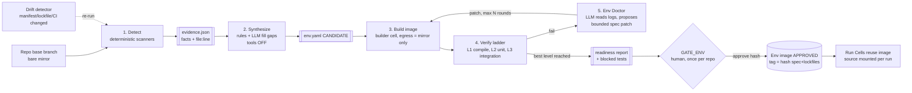

# 07 — Environment Synthesis: dựng môi trường sandbox từ source của user

## 1. Bài toán

User chỉ đưa vào một repo (URL + branch). Gatehouse phải tự trả lời được:
- Cần **toolchain** gì (JDK 17 hay 21, Maven 3.9, Node 20, Python 3.12…)?
- Cần **dependency** nào, lấy từ đâu (Maven Central, Nexus nội bộ, npm private)?
- Cần **service** gì để test chạy (Postgres, Redis, Kafka, WireMock…)? Seed dữ liệu thế nào?
- **Lệnh** build và test là gì, chạy test lẻ một class hoặc file ra sao?
- Test nào **không chạy được** trong sandbox, và vì sao?

Mục tiêu không phải "lúc nào cũng chạy được", mà là: **chạy được ở mức cao nhất có thể, và báo cáo trung thực phần còn lại** (giữ honest status của v1).

## 2. Nguyên tắc

| # | Nguyên tắc | Lý do |
|---|---|---|
| E1 | **Deterministic trước, LLM sau** | Phần lớn thông tin đã có sẵn trong repo (CI, devcontainer, manifest). LLM chỉ dùng để lấp chỗ trống và sửa lỗi từ log |
| E2 | Output là một **Environment Spec khai báo** (`env.yaml`), không phải Dockerfile tự do | Spec có schema nên validate được, diff được và review được. Dockerfile thì do compiler sinh ra từ spec |
| E3 | Mọi field trong spec có **provenance**: `SOURCE(file:line)` hoặc `INFERRED(reason)` | Giống P6 của v1: người duyệt biết field nào đoán, field nào có căn cứ |
| E4 | Chỉ dùng **base image đã được tuyển chọn**, không bao giờ chạy Dockerfile của repo trên host | Source của user là dữ liệu *không tin cậy* (nhất là PR head) |
| E5 | **Spec phải được chứng minh bằng cách chạy thật** (verify), không phải được khẳng định | [CSW] *proven by telemetry* |
| E6 | Spec sinh từ **base branch**, không từ PR head | PR có thể sửa `pom.xml`/CI để chèn lệnh độc |
| E7 | Môi trường là một **artifact có trust level** và được tái sử dụng | Promotion, không rebuild [SGX]. Image tính hash theo spec + lockfile |

## 3. Pipeline



### 3.1 Detect: scanner deterministic

Đọc nguồn theo thứ tự độ tin cậy giảm dần. Nguồn trước thắng nguồn sau khi có xung đột, nhưng xung đột vẫn được ghi lại:

| Ưu tiên | Nguồn | Lấy ra được gì |
|---|---|---|
| 1 | `.gatehouse/env.yaml` hoặc override của user trong Settings | Mọi thứ (user khẳng định) |
| 2 | `.devcontainer/devcontainer.json` (+ Dockerfile/compose mà nó tham chiếu) | Image, features (java, node…), `postCreateCommand`, service |
| 3 | **CI workflow** (`.github/workflows/*.yml`, `Jenkinsfile`, `.gitlab-ci.yml`) | `setup-java@ java-version`, `setup-node`, khối `services:` (postgres, redis…), các bước `run:` build/test, env var test. **Đây là nguồn tốt nhất trong thực tế**, vì CI là môi trường *đang chạy được* |
| 4 | `docker-compose*.yml`, `Dockerfile` | Service + version, port, biến môi trường của DB |
| 5 | Build manifest | `pom.xml` (`maven.compiler.release`, plugin surefire/failsafe/jacoco, profile), `mvnw` + `maven-wrapper.properties`, `build.gradle(.kts)` + `gradle-wrapper.properties`, toolchains, `package.json` (`engines`, `packageManager`, scripts `test`), lockfile, `pyproject.toml`, `go.mod`, `global.json` |
| 6 | Pin version | `.java-version`, `.nvmrc`, `.node-version`, `.tool-versions`, `.python-version`, `.sdkmanrc` |
| 7 | Cấu hình test | `application-test.yml`/`.properties` (JDBC URL → loại DB), Flyway/Liquibase migration, dùng Testcontainers (`org.testcontainers` trong dependency), WireMock |
| 8 | `README`, `CONTRIBUTING` | Hướng dẫn build bằng văn bản (chỉ dùng làm gợi ý cho bước LLM, có taint) |

Output: `evidence.json` gồm danh sách *fact* có citation, ví dụ:
```json
{ "fact": "jdk.version", "value": "17", "source": ".github/workflows/ci.yml:23", "kind": "SOURCE" }
{ "fact": "service", "value": {"image": "postgres:15"}, "source": ".github/workflows/ci.yml:31-40", "kind": "SOURCE" }
{ "fact": "uses_testcontainers", "value": true, "source": "pom.xml:88", "kind": "SOURCE" }
```

### 3.2 Synthesize: ghép facts thành spec
- Phần lớn được **map bằng rule**: stack template (`java-maven`, `java-gradle`, `node`, `python`, `dotnet`, `go`) + version từ fact.
- Còn chỗ trống hoặc xung đột (vd. CI dùng JDK 17 nhưng `pom.xml` ghi `release 21`) thì gọi LLM ở chế độ **quarantined** (`tools: []`, chỉ đọc `evidence.json` + README đã taint). LLM chỉ trả về **phần còn thiếu** theo schema, mỗi giá trị kèm `reason`. Mọi giá trị LLM đưa ra đều được gắn `INFERRED`.

### 3.3 Environment Spec (ví dụ)

```yaml
# env.yaml — artifact, có schema: registry/schemas/env-spec.schema.json
repo: payments-api
derived_from: { branch: main, sha: 9f3c2e1 }
stack: java-maven
toolchain:
  jdk:   { version: "17", distro: temurin,  provenance: "SOURCE .github/workflows/ci.yml:23" }
  maven: { version: "3.9.6", via: wrapper,  provenance: "SOURCE .mvn/wrapper/maven-wrapper.properties:1" }
system_packages: [ ]                         # apt, chỉ từ mirror allowlist
dependencies:
  resolver: maven
  mirror: gatehouse-mirror                   # settings.xml do Gatehouse sinh, trỏ vào mirror
  prefetch: "./mvnw -B -q dependency:go-offline"
  cache_key: [pom.xml, "**/pom.xml"]
services:
  - name: db
    image: postgres:15                       # pull qua mirror, tag được pin bằng digest khi build
    env: { POSTGRES_DB: payments_test, POSTGRES_USER: test, POSTGRES_PASSWORD: test }
    init: migrations                         # chạy Flyway với db rỗng
    seed: synthetic                          # PCI 6.5.5 - không bao giờ dùng dump thật
    provenance: "SOURCE .github/workflows/ci.yml:31-40"
env:
  SPRING_PROFILES_ACTIVE: test
  SPRING_DATASOURCE_URL: jdbc:postgresql://db:5432/payments_test
commands:
  build:      "./mvnw -B -q -o compile"
  test_all:   "./mvnw -B -o test"
  test_one:   "./mvnw -B -o test -Dtest={class}"           # slot {class} validate bằng regex
  coverage:   "./mvnw -B -o clean jacoco:prepare-agent test -Dtest={class}"
needs:
  container_runtime: true                    # Testcontainers -> chỉ chạy được ở runtime kata (§5)
egress: [mirror]                             # sau khi prefetch thì test chạy offline (-o)
resources: { cpus: 2, memory: 3g }
```

### 3.4 Build image: tách lớp, tái sử dụng

```
┌───────────────────────────────────────────────┐
│ L3  source           ← KHÔNG bake vào image; mount theo từng cell (05 §2.3)
├───────────────────────────────────────────────┤
│ L2  dependencies     ← dependency:go-offline; key = hash(lockfile/pom)
├───────────────────────────────────────────────┤
│ L1  toolchain        ← jdk 17 + maven 3.9.6;  key = hash(toolchain section)
├───────────────────────────────────────────────┤
│ L0  base (curated)   ← gatehouse/base-jammy, non-root, CA corp, Copilot+Codex CLI
└───────────────────────────────────────────────┘
```
- **Base image** do Gatehouse duy trì và quét CVE. Toolchain lấy từ nguồn đã pin (Temurin, nodejs.org…) qua mirror.
- Build chạy trong **builder cell** (BuildKit rootless bên trong microVM/gVisor), egress chỉ tới mirror. Script lifecycle (`npm postinstall`, plugin Maven) cũng chỉ chạy được ở đây.
- Thay đổi `pom.xml` thì chỉ L2 bị build lại. Hai repo cùng JDK/Maven thì dùng chung L1 (L1 là read-only, không chứa dữ liệu của repo nào).

### 3.5 Verify ladder: đo mức "chạy được"

| Mức | Kiểm chứng | Ý nghĩa với workflow |
|---|---|---|
| **L0 static** | Clone + parse được | Review chỉ được `INSPECTED_ONLY`, không có repro |
| **L1 compile** | `commands.build` PASS | Agent sửa code được, kiểm tra được bằng compile |
| **L2 unit** | `test_one` PASS trên một test có sẵn, `test_all` chạy xong (test fail có sẵn thì ghi vào baseline) | Repro RED/GREEN, TDD, legacy coverage |
| **L3 integration** | Test cần DB/service chạy được | Repro cho cả bug ở tầng DB/integration |

- Verify luôn ghi lại **baseline** gồm test pass, test fail sẵn và test flaky (chạy 2 lần). Nhờ vậy về sau repro RED không bị nhầm với test vốn đã fail.
- Test không chạy được thì phân loại `ENVIRONMENT_BLOCKED{reason}` (vd. `needs: hsm`, `needs: external-api`, `needs: windows`). Đây là honest status, không phải lỗi.

### 3.6 Env Doctor: LLM sửa môi trường bằng patch có giới hạn
Khi verify fail, agent `env-doctor` (tier workhorse, chạy trong cell, **chỉ đọc** log + spec + repo) đề xuất một **patch theo schema** lên `env.yaml`. Nó **không** được viết Dockerfile hay shell tùy ý. Các thao tác được phép:

| Op | Ví dụ |
|---|---|
| `set_toolchain_version` | jdk 17 → 21 |
| `add_system_package` | `libpq-dev` (phải có trong allowlist của mirror) |
| `add_service` | `redis:7` (image phải có trong allowlist) |
| `set_env` | `TZ=UTC` (không phải secret, có validate) |
| `set_command` | đổi `test_one` cho module con: `-pl core -Dtest={class}` |
| `mark_blocked` | test `*IT` cần HSM → `ENVIRONMENT_BLOCKED` |

- Mỗi vòng: patch → build lại (chỉ những layer bị ảnh hưởng) → verify → ghi event. Tối đa N vòng (mặc định 5) và có budget token.
- Lỗi hay gặp được xử lý bằng **rule trước khi tới LLM**: `invalid target release: 21` → đổi JDK; `Connection refused :5432` → thêm postgres; `Could not resolve artifact` → báo thiếu mirror hoặc credential (cần người xử lý). LLM chỉ dùng khi không có rule nào khớp.

> Hướng "agent tự dựng môi trường chạy được cho repo" đã có các công trình nghiên cứu (vd. Repo2Run, ExecutionAgent). Điểm khác của Gatehouse: agent chỉ được **đề xuất patch có schema**, code mới là thứ chạy và quyết định, còn người duyệt kết quả cuối.

### 3.7 GATE_ENV: người duyệt một lần cho mỗi repo
Console hiện cho người duyệt:
- spec, trong đó mỗi field được đánh dấu SOURCE hoặc INFERRED kèm link `file:line`;
- mức verify đạt được và baseline test;
- danh sách test bị `ENVIRONMENT_BLOCKED`;
- diff so với lần approve trước.

Approve gắn với `hash(env.yaml)`. Image trở thành `APPROVED` và mọi Run Cell của repo đó dùng lại image này. Tùy chọn: Gatehouse mở PR thêm `.gatehouse/env.yaml` hoặc `.devcontainer/` vào repo, để team cùng dùng và cùng review (paved road [SGX]).

### 3.8 Drift
- Hash các input của spec: manifest, lockfile, CI workflow, file pin version, devcontainer.
- Hash đổi trên base branch → chạy lại Detect + Verify ở chế độ incremental. Nếu spec không đổi thì không cần gate lại. Nếu spec đổi thì GATE_ENV lại, kèm diff.
- **PR sửa build file** (`pom.xml`, `package.json`, lockfile, CI): review vẫn dùng env của base. Muốn chạy test với dependency mới của PR thì dựng một *env tạm* trong builder cell có taint `untrusted`, egress chỉ tới mirror, không bao giờ promote, và hủy sau run. Đồng thời policy đánh dấu PR này là rủi ro cao (03 §3.1 autonomy ceiling).

## 4. Các trường hợp khó

| Tình huống | Cách xử lý |
|---|---|
| **Testcontainers / test cần Docker** | Không bao giờ đưa docker socket của host vào cell. Với runtime **Kata microVM**, chạy một dockerd *bên trong VM* (VM là ranh giới). Container con pull image qua mirror. Với gVisor/runc: chuyển sang dùng service khai báo trong spec (nếu test cho phép cấu hình JDBC URL), không được thì `ENVIRONMENT_BLOCKED` |
| **Registry nội bộ** (Nexus, npm private) | Mirror trên host giữ credential và proxy registry nội bộ. Cell chỉ thấy mirror; `settings.xml`/`.npmrc` do Gatehouse sinh, không chứa token |
| **Monorepo nhiều module/ngôn ngữ** | Spec có `modules[]`, mỗi module có stack và command riêng. Enumerate của review map hunk về đúng module |
| **DB cần schema + dữ liệu** | Chạy migration (Flyway/Liquibase) lên DB rỗng, seed từ fixture của test hoặc factory sinh synthetic data. Không bao giờ dùng dump thật (PCI) |
| **Phụ thuộc hệ thống bên ngoài** (payment gateway, HSM, core banking) | WireMock nếu repo đã có stub. Không có thì `ENVIRONMENT_BLOCKED{needs: external}` |
| **Native lib, tool build** (protoc, libpq) | `add_system_package` từ apt mirror có allowlist |
| **Chỉ chạy được trên Windows** (.NET Framework, WPF) | Ngoài phạm vi cell Linux → L0 static, ghi rõ trong readiness report |
| **Build cần secret** (vd. license key) | Không đưa vào cell. Nếu build bắt buộc phải có thì test liên quan bị `ENVIRONMENT_BLOCKED`, ghi lý do |
| **Test flaky / phụ thuộc thời gian** | Baseline chạy 2 lần, test flaky được đánh dấu và loại khỏi kết luận repro |

## 5. Lựa chọn runtime theo `needs`

| `needs` của spec | runc-hardened | gVisor | **Kata microVM** |
|---|---|---|---|
| Compile / unit test | ✅ | ✅ | ✅ |
| Service sidecar (DB) | ✅ | ✅ | ✅ |
| Container runtime (Testcontainers, docker build) | ❌ (cần socket host) | ⚠️ hạn chế | ✅ dockerd trong VM |
| Sandbox riêng của Codex (Landlock) | ✅ | ⚠️ | ✅ |
| Overhead | thấp nhất | thấp | cao hơn (kernel + RAM dành riêng) |

Scheduler chọn runtime **thấp nhất mà vẫn đáp ứng `needs`**, nhưng không thấp hơn mức tối thiểu mà policy quy định (vd. PR từ fork, repo `pci.scope: cde` → bắt buộc Kata).

## 6. Trải nghiệm onboarding repo (console)

1. User nhập URL repo + branch, hoặc chọn từ danh sách GitHub.
2. Gatehouse clone vào mirror → Detect (vài giây) → hiện bảng facts có citation.
3. Synthesize → Build → Verify chạy nền, hiện tiến độ (L0 → L1 → L2 → L3).
4. Env Doctor chạy nếu cần, hiện từng patch kèm log.
5. User xem spec và readiness report, sửa tay nếu muốn (UI chỉnh `env.yaml` theo schema), rồi **Approve**.
6. Repo sẵn sàng. Mọi workflow (review, ticket→PR, legacy tests) dùng image đã approve.

## 6b. Host mode (Version A, xem [08](08-delivery-host-then-sandbox.md))

- `env.yaml` có `target: host`. Bỏ qua bước Build image. `toolchain` là **host fingerprint** đo được (`mvn -v`, `java -version`, `node -v` chạy qua đúng shell của user), không phải thứ cần cài.
- Detect và Verify (L1/L2) dùng chung code với cell mode. Baseline test trên host được lưu thành artifact.
- Khi chuyển sang Version B: fingerprint + `commands` đã verify trên host là **seed** cho spec của cell, và baseline của host là chuẩn cho **parity check** (test pass trên host so với test pass trong cell).

## 7. Thay đổi trong các tài liệu khác

- 03 step contract: thêm `requires_env_level: L2`. Engine từ chối chạy step (trả `ENVIRONMENT_BLOCKED`) khi repo chưa đạt mức yêu cầu. Ví dụ review vẫn chạy ở L0 nhưng bỏ bước evidence/repro.
- 04 roadmap: **Env Synthesis cho stack `java-maven`** (detect + spec + build + verify L1/L2, chưa có Doctor) nằm trong Phase 1, vì PR review cần nó để repro. Doctor + L3 + stack khác ở Phase 2–3.
- Eval suite mới `env-synthesis`: tập repo mẫu (OSS) có kết quả mong đợi, chấm theo mức verify đạt được, số vòng Doctor và thời gian.
