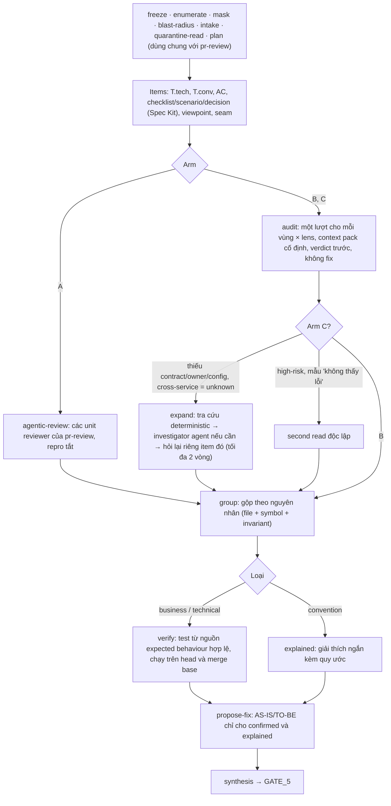

# 09 — Review theo batch, chứng minh sau: thử nghiệm ba arm A/B/C

Tài liệu này mô tả workflow `pr-review-audit` (code: `packages/workflows/src/audit*.ts`, `context-pack.ts`, `arms.ts`; khai báo: `registry/workflows/pr-review-audit.yaml`). Workflow `pr-review` hiện tại **không đổi** và vẫn là mặc định. `pr-review-audit` là ứng viên, được đặt cạnh baseline để đo, chưa phải quyết định kiến trúc.

## 1. Vì sao cần thử

| Quan sát | Nguồn | Giới hạn khi áp dụng cho Gatehouse |
|---|---|---|
| Agent loop tốn khoảng 1.000× token so với một lượt; cùng task có thể chênh tới 30× | Bai et al., arXiv 2604.22750 | Không phải phép so cùng PR giữa agentic review và single-pass review |
| Trên AACR-Bench, chế độ agent của DeepSeek-V3.2 có recall 4,78%, so với 36,54% ở chế độ no-context | arXiv 2601.19494 | Chỉ nói về harness và model đã thử, không áp dụng cho mọi agent |
| Context dư thừa làm điểm giảm (DeepSeek-v3.1: 42,51 với oracle, 48,13 với BM25 top-1, 36,42 với top-5) | CodeFuse-CR-Bench, arXiv 2509.14856 | Top-1 là *file bổ sung được truy hồi*, không có nghĩa "đọc một file là đủ" |
| Bắt model giải thích và đề xuất sửa làm tỷ lệ bác bỏ code đúng tăng từ 26,2% lên 73,2% (GPT-4o, HumanEval) | arXiv 2603.00539 | Ủng hộ việc tách phát hiện khỏi đề xuất sửa; không có nghĩa mọi giải thích đều hại |
| Tách hiểu requirement (`ruleMiner`) khỏi kiểm tra code (`codeAuditor`) | NIO, arXiv 2605.17926 | Paper chưa đánh giá recall của rule mining |

Mức 54,8% → 16,3% là kết quả của *Fix-guided Verification Filter* trên HumanEval (arXiv 2603.00539 §7.2), không phải của pipeline NIO. Tài liệu này không dùng nó làm bằng chứng cho test sinh từ decision table.

Các số đo của Gatehouse (tỷ lệ prompt:completion, token mỗi dòng thay đổi, số finding mỗi lượt) **chưa được xác minh từ log gốc** trong repo này. Lệnh `run review-arms` (§5) được làm ra để đo những số đó.

## 2. Pipeline



### Layer

| Layer | Thành phần | Contract |
|---|---|---|
| 1. Interface & ingestion | `run pr-review --arm`, `run review-arms`; gateway `/v1/chat/completions` | Tier alias, run token, DLP, budget; `rateLimit {rpm, tpm, countCachedTokens}` theo provider |
| 2. Orchestration | Các step `agentic-review`, `audit`, `investigate`, `group`, `verify`, `propose-fix` | Mỗi step lưu `AuditState` thành artifact, nên resume không gọi lại model |
| 3. Data & state | Event `MODEL_CALL` (có `cachedPromptTokens`), `STRUCTURED_CALL`, `RATE_LIMIT_WAIT`, `REPRO_RUN`; `pkg.audit` | Hash của rule tính trên **mọi** file nguồn (checklist, spec), không chỉ spec |
| 4. Infrastructure | Quota chung cho cả máy (`RateLimiter` dùng chung trong process); test chạy trên host hoặc cell | 429/5xx: backoff theo `Retry-After`; 402 (hết budget): dừng, không retry |

## 3. Bốn quyết định từ phản biện

**3.1 "Không thấy lỗi" khác "chưa kiểm tra được".** Verdict gồm `pass | fail | not_applicable | cannot_determine`. Ở arm C, item hết vòng điều tra mà vẫn thiếu dữ liệu thành `unresolved`, kèm câu hỏi còn thiếu và những gì không có trong repo. Item `mandatory` (`T*.tech`, viewpoint bắt buộc) ở trạng thái `cannot_determine`, `unresolved` hoặc `not_run` làm review thành **incomplete**. SUMMARY.md liệt kê các item này trong mục riêng "Not checked", không gộp vào phần đã qua.

**3.2 Điều tra không chỉ dành cho candidate.** `routeItems` (arm C) mở điều tra khi có một trong các lý do sau:

| Lý do | Điều kiện | Hành động |
|---|---|---|
| `candidate` | `fail` có trích dẫn khớp code | verify (mọi arm) |
| `missing_context` | `cannot_determine` hoặc `missing_context` khác rỗng | expand |
| `cross_service_unknown` | auditor không xác định được ảnh hưởng xuyên service | expand bằng tên lấy từ boundary signal |
| `high_risk` | viewpoint bắt buộc, hoặc rule nghiệp vụ trên diff có rủi ro, mà kết quả là pass/n.a. | second read |
| `audit_sample` | 10% số pass/n.a. còn lại (tối thiểu 1); ưu tiên pass không có evidence; thứ tự cố định theo run id | second read |

Giới hạn: `maxInvestigations` (30) và `expansionRounds` (2), cộng với token budget. Item vượt giới hạn được đánh dấu rõ là chưa điều tra.

**3.3 Context đủ cho kết luận, không chỉ nhỏ.** Context pack của mỗi vùng gồm hunk có đánh số dòng, các caller ngoài diff và **boundary signal**:

| Loại | Ví dụ được nhận diện |
|---|---|
| `http-client` | `@FeignClient`, `RestTemplate`, `WebClient`, field kiểu `*Client` hoặc `*Api` |
| `messaging` | `KafkaTemplate`, `@KafkaListener`, `@RabbitListener`, `StreamBridge` |
| `transaction` | `@Transactional`, `TransactionTemplate` |
| `resilience` | `@Retry`, `@CircuitBreaker`, `timeout` |
| `authorization` | `@PreAuthorize`, `hasRole`, `SecurityContextHolder` |
| `idempotency` | `Idempotency-Key`, `dedup` |

Kèm theo là các dòng contract/config mà repo đang chứa: OpenAPI, proto, Avro, AsyncAPI và các key retry/timeout/kafka trong `application*.yml`. Contract của service nằm ở repo khác thì không tìm được. Khi đó prompt yêu cầu trả `cross_service: unknown` thay vì đoán. Batch được chia theo **vùng code dùng chung** (T unit, hoặc viewpoint nằm trọn trong một T unit) × lens (`code` hoặc `spec`), không chia theo số item cố định.

**3.4 Không mặc định k lượt.** Mỗi item chỉ có một lượt. Lượt thứ hai chỉ chạy cho `high_risk` và `audit_sample` ở arm C. Chỉ nên nâng k khi bảng so sánh cho thấy số finding confirmed mới tăng đủ để bù cho tổng chi phí, kể cả verify.

Phần gộp trùng **không** dùng `(item, file, lines)`. `groupByRootCause` lấy khoá là `file của cause + symbol bao quanh`, rồi gộp các candidate có invariant giống nhau (Jaccard ≥ 0,3) hoặc thuộc cùng item. Mọi vị trí được giữ lại làm evidence. Ngưỡng 0,3 **chưa được hiệu chỉnh** trên dữ liệu thật.

## 4. Chính sách xác minh (giống nhau cho A, B và C)

| Trạng thái | Điều kiện | Verdict trong package |
|---|---|---|
| `confirmed` | Nguồn expected behaviour hợp lệ, test **fail bằng assertion** (`<failure>`) trên head và pass trên merge base | STANDS |
| `confirmed-preexisting` | Như trên nhưng test cũng fail trên merge base | STANDS |
| `withdrawn` | Test pass trên head | WITHDRAWN |
| `unconfirmed` | Test không chạy, hoặc fail do **exception** (`<error>`, thường là lỗi mock/setup) | UNCHALLENGED |
| `blocked` | Không có môi trường L2 đã duyệt, không có nguồn expected behaviour, hoặc verifier không viết được test | UNCHALLENGED |
| `explained` | Lỗi convention: giải thích ngắn kèm quy ước, không cần test | STANDS |

"Nguồn hợp lệ" là một trong hai loại:
- id của AC/rule đã có trong run;
- trích dẫn `file:line:quote` khớp code ở head (contract, schema, hành vi caller).

Ý kiến của model không được tính là nguồn. AS-IS/TO-BE chỉ được sinh ở `propose-fix`, sau khi có kết quả xác minh. Hiện chỉ hỗ trợ Java/Maven, qua `runJavaRepro`.

## 5. Thử nghiệm

```bash
node bin/gatehouse.mjs run review-arms <repo> --pr N --arms A,B,C [--budget-tokens N]
```

Lệnh này chạy tuần tự để các arm không tranh quota và để wall-clock so sánh được với nhau. Nếu head đổi giữa các arm, lệnh cảnh báo. Kết quả nằm ở `~/.gatehouse/experiments/<id>/arms.md` và `arms.json`.

| Chỉ số | Cách đo |
|---|---|
| Candidate, candidate có citation sai, số nguyên nhân sau gộp | `pkg.audit.candidates` |
| Confirmed / withdrawn / unconfirmed / blocked / explained | `Finding.status` |
| Relative confirmed recall | Tính trên **hợp** các finding confirmed của những arm được so. Đây không phải recall thật |
| Item chưa kiểm tra được, trong đó thiếu contract/owner | `pkg.audit.items` |
| Vấn đề mới do điều tra tìm ra | Investigation có `before ≠ fail` và `after = fail` |
| Token theo giai đoạn (review / investigation / verification), cached tokens, số request | Event `MODEL_CALL` theo `stepId` |
| Token verify trên mỗi nguyên nhân đã test, số lần và thời gian chạy test | `MODEL_CALL` `verify-*`/`fix-*`, `REPRO_RUN` |
| Thời gian chờ quota, wall-clock | `RATE_LIMIT_WAIT`, timestamp của event |
| **Không đo được tự động** | Thời gian người đọc report; token Codex (đi qua subscription, không qua gateway) |

Hai PR ecommerce-jhipster#1 và petclinic#2632 chỉ đủ để **kiểm tra cơ chế**. Muốn chọn kiến trúc thì cần một tập PR của team đã gán nhãn. Cách gán nhãn: lưu quyết định ở GATE_5 thành eval case bằng `gatehouse retro`.

### Ma trận khả thi và đánh đổi

| Khía cạnh | Đánh giá |
|---|---|
| Kỹ thuật | Các phần deterministic (item, pack, routing, gộp, tra cứu) là code thuần và có test. Rủi ro nằm ở chất lượng verdict của DeepSeek V4.x Flash và GLM 5.x trên pack thật. **Chưa đo** |
| Chi phí | Mỗi PR có `Σ vùng × 2 lens` lượt audit, cộng điều tra (C, có giới hạn), verify (agentic, tối đa 10) và fix. Verify có thể chiếm phần lớn token và thời gian, vì vậy được đo riêng |
| Độ trễ | Với 1M TPM, khoảng 120k token mỗi call thì chạy được chừng 8 call/phút **nếu** cached token bị tính vào quota. Thời gian thực còn phụ thuộc dependency giữa các step, thời gian chạy test và tải chung. Chưa có p95/p99 |
| Đánh đổi | B rẻ và dễ đoán, nhưng bỏ ngỏ những gì nằm ngoài pack. C tốn thêm call để đổi lấy coverage, và phần thêm đó có giới hạn. A là baseline |
| Fallback | Một batch hỏng thì các item của nó thành `not_run`, có ghi chú. Hết budget thì phần chưa làm được ghi rõ. Resume tiếp tục từ step còn dở |

## 6. Chưa xác minh, cần đo trước khi chọn

- Có cache hit hay không. Theo tài liệu DeepSeek, request `A+C` gửi ngay sau `A+B` có thể chưa hit, và cache là best-effort. Các batch trong cùng một vùng chạy tuần tự (song song giữa các vùng), nhưng Gatehouse **chỉ tin số `prompt_cache_hit_tokens` mà provider trả về**. Deployment tự host cần kiểm tra lại serving engine và routing.
- Gateway của công ty có tính cached token vào TPM hay không. `countCachedTokens` mặc định là `true` (thận trọng). Chỉ đặt `false` sau khi đã đo.
- `response_format: json_object` của DeepSeek chỉ bảo đảm JSON hợp lệ, không bảo đảm đúng schema. `json_schema` cần guided decoding ở phía server. Gatehouse luôn validate lại và repair tối đa 1 lần.
- Item `pass` vẫn còn `missing_context` thì được giữ là `pass` kèm ghi chú (chưa hạ xuống `unresolved`). Cần dữ liệu để quyết định.
- Chưa có bước LLM rule mining (S1). Rule hiện lấy từ AC của quarantine-reader và parse deterministic file Spec Kit.
- Chưa tra cứu được contract ở repo khác (multi-repo). Những item này kết thúc ở `unresolved`, kèm lý do.
